# Android AI Coder Skill、MCP 与 Command 配置指南

> 适用对象：Android 客户端开发、测试、技术负责人
>
> 关联文档：[Android-AI-Coder-落地.md](Android-AI-Coder-落地.md)
>
> 版本：v1.9 ｜ 日期：2026-11-13

本文讲三件事：Skill 的安装与项目适配、Command 的安装与验证、MCP 的凭证获取与配置。覆盖 Qoder CN 桌面端、Android Studio Qoder CN 插件、Cursor、Trae。Skill 与 Command 的日常使用见主文档。

---

## 0. 前置条件

| 项目 | 要求 |
|---|---|
| Node.js | 已安装 Node.js 18+，终端可执行 `node -v` 和 `npx -v` |
| Skill 源文件 | 仓库 `skill/` 目录下的七个 Skill：三个流程 Skill（`figma-android-ui`、`android-api-ds`、`fix-tapd-android-bug`）+ 四个工程骨架 Skill（命名 `android-naming`、模块 `android-module`、工程 `android-project`、构建逻辑 `android-build-logic`） |
| 客户端 | Qoder CN 桌面端 / Android Studio Qoder CN 插件 / Cursor / Trae 任选其一 |
| Figma | 有目标设计稿的访问权限 |
| TAPD | 有目标项目空间和 Bug 的访问权限 |
| 网络 | 能访问 npm 源、Figma API、TAPD API |

---

## 1. Skill 配置

Skill 由 `SKILL.md` 和 `references/` 组成，放进客户端扫描的目录后重新加载即可生效，不需要编译或安装依赖。

### 1.1 安装位置

| 级别 | Qoder 路径 | 适用场景 |
|---|---|---|
| 用户级 | `C:\Users\<用户名>\.qoder-cn\skills\` | 个人使用，所有项目可用 |
| 项目级 | `<项目根目录>\.qoder\skills\` | 团队共享，跟随仓库版本管理 |

推荐：个人日常开发用用户级；团队统一规范用项目级，把 `.qoder/skills/` 提交到仓库，保证所有人使用同一版本。

其他客户端读取的是同一份 `SKILL.md`，只需换目录：

| 客户端 | 项目级 | 用户级 |
|---|---|---|
| Qoder CN | `.qoder/skills/` | `~/.qoder-cn/skills/` |
| Claude Code | `.claude/skills/` | `~/.claude/skills/` |
| Cursor | `.cursor/skills/` | `~/.cursor/skills/` |
| Trae | `.trae/skills/` | `~/.trae/skills/` |
| CodeBuddy | `.codebuddy/skills/` | `~/.codebuddy/skills/` |

> 多客户端共用一份源码、避免版本漂移的做法（软链 / 目录联接）见主文档 0.6。

### 1.2 目录结构

把七个 Skill 文件夹（三个流程 Skill + 四个工程骨架 Skill）放到 skills 目录下：

```
skills/
├── figma-android-ui/
│   ├── SKILL.md
│   └── references/
│       ├── drawable-xml-spec.md
│       ├── xml-layout-spec.md
│       ├── kotlin-code-style.md
│       └── architecture-spec.md
├── android-api-ds/
│   ├── SKILL.md
│   ├── README.md
│   └── references/
│       └── code-templates.md
├── fix-tapd-android-bug/
│   └── SKILL.md
├── android-naming/
│   ├── SKILL.md
│   └── references/
│       ├── view-id-naming.md
│       ├── layout-file-naming.md
│       ├── color-naming.md
│       ├── ...
│       └── network-naming.md
├── android-module/
│   ├── SKILL.md
│   └── references/
│       ├── business-module.md
│       ├── library-module.md
│       └── build-conventions.md
├── android-project/
│   ├── SKILL.md
│   └── references/
│       ├── project-structure.md
│       ├── build-config.md
│       └── app-module.md
└── android-build-logic/
    ├── SKILL.md
    └── references/
        ├── build-logic-structure.md
        ├── convention-plugins.md
        ├── support-utils.md
        └── troubleshooting.md
```

要求：

- 每个 Skill 必须有 `SKILL.md`。
- 文件夹名、`SKILL.md` 的 frontmatter `name`、Command 中的引用三者保持一致：`figma-android-ui`、`android-api-ds`、`fix-tapd-android-bug`、`android-naming`、`android-module`、`android-project`、`android-build-logic`。
- `references/` 中的规范文件保持单一职责，不要把命名、布局、代码风格混在一个文件里。
- 命名规则只维护在 `android-naming`（共 15 份 references），其余 Skill 不再重复放命名文件；模块与工程的目录、namespace、applicationId、约定插件 id 规则也以它为准。

### 1.3 安装与加载

**方式一：手动复制（用户级）**

```text
把 figma-android-ui、android-api-ds、fix-tapd-android-bug、
android-naming、android-module、android-project、android-build-logic 七个文件夹
复制到 C:\Users\<用户名>\.qoder-cn\skills\
```

**方式二：项目级安装**

```text
在项目根目录创建 .qoder\skills\
把七个 Skill 文件夹复制进去
```

**加载**

- 桌面端：重新打开 Qoder，或在对话中执行 `/skills reload`。
- IDE 插件：重启 Android Studio，或执行 `/skills reload`。
- 查看列表：`/skills list`。

### 1.4 验证 Skill 是否生效

| 客户端 | 查看位置 |
|---|---|
| Qoder CN 桌面端 | 左侧「扩展」→「扩展管理」→「技能」标签 |
| Android Studio 插件 | `Settings → Other Settings → Qoder CN → 技能、智能体与指令` |
| 对话 | `/skills list` |

验证方式：

1. 七个 Skill（三个流程 Skill + `android-naming`、`android-module`、`android-project`、`android-build-logic`）都出现在列表中。
2. 输入触发语句，客户端能识别并调用对应 Skill：

| 输入示例 | 应调用 |
|---|---|
| 「根据这个 Swagger 文档生成网络请求代码」 | `android-api-ds` |
| 「按这个设计稿生成页面布局」 | `figma-android-ui` |
| 「修复这个 TAPD Bug：<链接>」 | `fix-tapd-android-bug` |
| 「按 android-naming 检查这次改动的命名」 | `android-naming` |
| 「创建业务模块 module_user」 | `android-module` |
| 「新建一个 Android 工程」 | `android-project` |
| 「新增一个约定插件」 | `android-build-logic` |

3. 如果没识别，检查文件夹层级是否多套了一层，例如 `skills/android-api-ds/android-api-ds/SKILL.md` 是错误结构。

### 1.5 Skill 与项目的适配

这七个 Skill 内置的是参考项目的规范。换到新项目时，先确认并调整：

| 文件 | 需要确认的内容 |
|---|---|
| `android-api-ds/references/code-templates.md` | 基类名、包名、响应封装、DataSource 基类 |
| `android-naming/references/network-naming.md` | 实体、Service、DS、VM 的命名 |
| `android-naming/references/package-naming.md` | 模块内的包结构（view/data/util 等） |
| `android-naming/references/module-naming.md` | 模块目录（`app` / `lib_` / `module_`）、namespace、`include`、`applicationId` |
| `android-naming/references/build-logic-naming.md` | `build-logic` / `convention` 目录、插件 id、`ydj-*` 别名、`XxxConventionPlugin` 类名 |
| `android-naming/references/color-naming.md` | 颜色是否统一放在 `lib_common` |
| `android-naming/references/` 其余命名文件 | 控件 ID、布局文件名、类名、方法/变量、字符串、Drawable 与图片、主题与动画的命名前缀 |
| `figma-android-ui/references/architecture-spec.md` | 模块依赖、DI、路由、事件总线 |
| `figma-android-ui/references/drawable-xml-spec.md` | Drawable 复用和创建规则 |
| `android-module/references/build-conventions.md` | 约定插件名、`isModule` 开关、双清单切换、资源前缀 |
| `android-module/references/business-module.md` | 页面参考模块（默认 `module_wallet`）、页面模板、logo 模板 `module_me_logo` |
| `android-module/references/library-module.md` | 基础库参考模块（默认 `lib_pay`）、对外 Helper 写法 |
| `android-project/references/project-structure.md` | `settings.gradle.kts`、根构建脚本、版本目录、`build-logic` 插件注册 |
| `android-project/references/build-config.md` | `AppBuildConfig` / `AppSignConfig`、flavors、签名与 APK 命名 |
| `android-project/references/app-module.md` | `app` 壳的构建脚本、清单、MainActivity 与底部导航 |
| `android-build-logic/references/build-logic-structure.md` | `build-logic/settings.gradle.kts`、`convention/build.gradle.kts`、插件注册与 `includeBuild` 接入 |
| `android-build-logic/references/convention-plugins.md` | 8 个约定插件的职责、apply 关系与代码骨架 |
| `android-build-logic/references/support-utils.md` | `AppBuildConfig` / `AppSignConfig` / `KotlinAndroid`、flavors、签名与分发 |

> Skill 不是装完就结束。项目基类或目录调整后，要同步更新 references，否则生成结果会和工程实际脱节。

**维护要求**

- 每个 reference 只负责一类规则，不要把命名、布局、代码风格混在一个文件里。
- 项目基类、包名、响应封装变更时，同步更新 `code-templates.md` 和 `architecture-spec.md`。
- Skill 变更记录版本号，例如 `v1.0.0` → `v2.0.0`。
- 每次项目迭代后，把新出现的反例补充进检查清单。
- 团队内指定维护人，避免 Skill 与工程实际逐渐脱节。

### 1.6 Skill 常见问题

| 现象 | 可能原因 | 处理 |
|---|---|---|
| 技能列表看不到 | 目录层级错误、缺少 `SKILL.md` | 检查 `skills/<name>/SKILL.md`，执行 `/skills reload` |
| 名称不对 | 文件夹名与 frontmatter `name` 不一致 | 统一为 `android-api-ds` 等名称 |
| 触发了但没有工具 | MCP 未启用 | 按第 6~9 节配置对应客户端的 MCP |
| 生成代码不符合项目 | references 未适配 | 更新基类、包名、响应封装等配置 |
| 换用 Cursor/Trae/CodeBuddy 后技能不出现 | 各客户端 Skill 目录不同 | 按 1.1 的对照表放置或建软链，`SKILL.md` 正文不用改 |

---

## 2. Command 配置

Command 是 `commands` 目录下的一份 Markdown 文件，**文件名即命令名**。安装级别与 Skill 一致：

| 级别 | Qoder 路径 | 适用场景 |
|---|---|---|
| 用户级 | `C:\Users\<用户名>\.qoder-cn\commands\` | 个人使用，所有项目可调用 |
| 项目级 | `<项目根目录>\.qoder\commands\` | 团队共享，跟随仓库版本管理 |

把仓库中的三个命令文件复制进去：

```
commands/
├── android-create-project.md   # 调用名：/android-create-project
├── android-feature.md          # 调用名：/android-feature
└── android-review.md           # 调用名：/android-review
```

要求：

- 文件名使用 kebab-case，与调用名一致：`android-feature.md` → `/android-feature`。
- frontmatter 只写 `description`，用于斜杠列表中的说明。
- 命令正文里引用的 Skill 路径必须是本机真实存在的路径；项目级安装时，路径改成团队约定的位置。
- Command 依赖第 1 节安装的 Skill，先装 Skill 再装 Command：日常开发命令依赖三个流程 Skill（命名由 `android-naming` 提供）；`/android-create-project` 还依赖 `android-project`、`android-module`、`android-build-logic`。
- 命令正文引用 Skill 时优先写名称（如 `figma-android-ui`），不要写死客户端专属的绝对路径，便于在其他客户端复用。

**三个命令的分工**

| Command | 阶段 | 依赖 Skill |
|---|---|---|
| `/android-create-project` | 工程骨架 → `lib_common` → `lib_coremodel` / `lib_pay` → 业务模块 → 收口验证 | `android-project`、`android-build-logic`、`android-module`；命名全程按 `android-naming` |
| `/android-feature` | UI 还原 → 接口链路 → 数据上屏 → 审查 | `figma-android-ui`、`android-api-ds`，最后复用 `/android-review` 的标准 |
| `/android-review` | 概览 → 问题表 → 修复方案 | `android-api-ds`（网络链路）、`figma-android-ui`（UI 与资源），命名按 `android-naming` |

`/android-create-project` 的每一阶段都要编译通过才进入下一阶段；未带 `-y` 时每阶段停下确认，带了 `-y` 也仍输出门禁摘要。

> 其他客户端没有自定义斜杠命令机制时，把命令正文当作规则文件或固定 Prompt 使用即可，编排逻辑不变，见主文档 0.6。

### 2.1 加载与验证

1. 重新打开客户端，或在对话输入 `/`，列表中应出现 `android-create-project`、`android-feature` 和 `android-review`。
2. 输入 `/android-feature` 不带参数，应一次性问齐设计稿链接、接口文档链接和功能名，而不是报错。
3. 输入 `/android-review`，应先读取 diff，再输出「概览 → 问题表 → 修复方案」。
4. 输入 `/android-create-project` 不带参数，应一次性问齐工程根目录、工程名、包名域、applicationId、App 名、版本号与 `lib_http` 处置，而不是直接开始建目录。
5. 看不到命令时，确认文件在 `commands` 目录、扩展名是 `.md`，再重开客户端或重启 IDE。

> 命令与 Skill 不要混放：Skill 进 `skills/`，Command 进 `commands/`。放错目录时，两边都不会出现在列表里。

### 2.2 Command 常见问题

| 现象 | 可能原因 | 处理 |
|---|---|---|
| 输入 `/` 看不到命令 | 文件不在 commands 目录、扩展名不是 `.md`、客户端未重载 | 放到 `~/.qoder-cn/commands/` 或 `.qoder/commands/`，重开客户端或重启 IDE |
| 命令名与预期不同 | 文件名即命令名 | 文件名改成 `android-feature.md`，调用 `/android-feature` |
| 命令执行但不按规范 | Skill 未安装，或命令中引用的 Skill 路径不存在 | 先完成第 1 节的 Skill 安装；核对命令正文里的路径与本机一致 |
| 参数被识别错 | 链接域名不在识别列表，或文本与链接混排 | 显式写「设计稿：<链接>」「接口文档：<链接>」「功能名：<名称>」 |
| 想每阶段确认却一路跑完 | 输入了 `-y` | 去掉 `-y`；或在任务开始时说明「每阶段停下等我确认」 |
| 命令只跑了 UI 就结束 | 未提供接口文档，或接口未定稿 | 补齐接口文档；按主文档 4.6 的命令分工改为单点 Skill |
| `/android-create-project` 中途停住 | 目标目录非空，或 `lib_http` 未决策 | 换空目录或确认沿用；明确 `lib_http` 是补建还是并入 `lib_coremodel` |
| 命令与项目级 Skill 冲突 | 项目级和用户级同名 Skill 并存 | 只保留一处；团队规范统一用项目级 |
| 换用其他客户端后 `/` 里没有命令 | 该客户端不支持自定义斜杠命令 | 把命令正文作为规则文件或固定 Prompt 使用；Skill 仍可单独触发（见主文档 0.6） |

---

## 3. 获取 Figma API Key

Figma MCP 需要个人访问令牌（Personal Access Token）才能读取设计文件。

**操作步骤**

1. 登录 Figma，点击左上角头像。
2. 选择「Settings」。
3. 切换到「Security」标签。
4. 在「Personal access tokens」区域点击「Generate new token」。
5. 填写 Token 名称，例如 `qoder_ai`；选择有效期，例如 90 天。
6. 勾选只读权限。至少需要：
   - `current_user:read`
   - `file_content:read`
   - `file_metadata:read`
   - `file_versions:read`
   - `library_assets:read`
   - `library_content:read`
   - `team_library_content:read`
   - `file_dev_resources:read`
   - `folders:read`
   - 如需读取评论，再勾选 `file_comments:read`
7. 点击「Generate token」。
8. **立即复制 token**，页面关闭后无法再次查看。

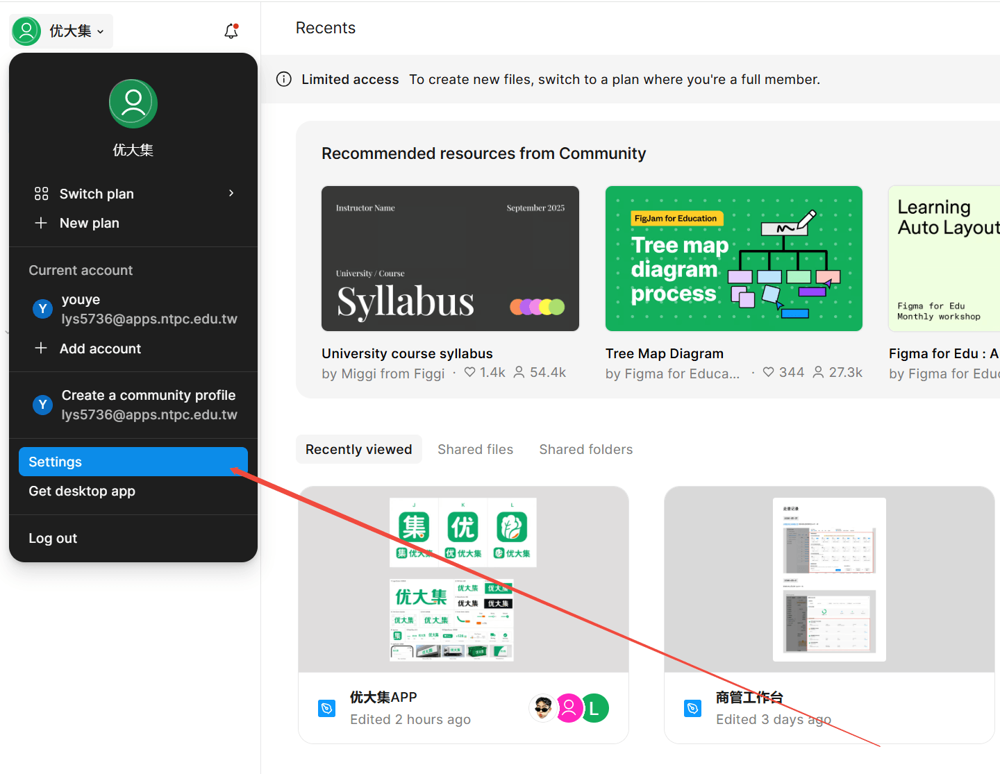

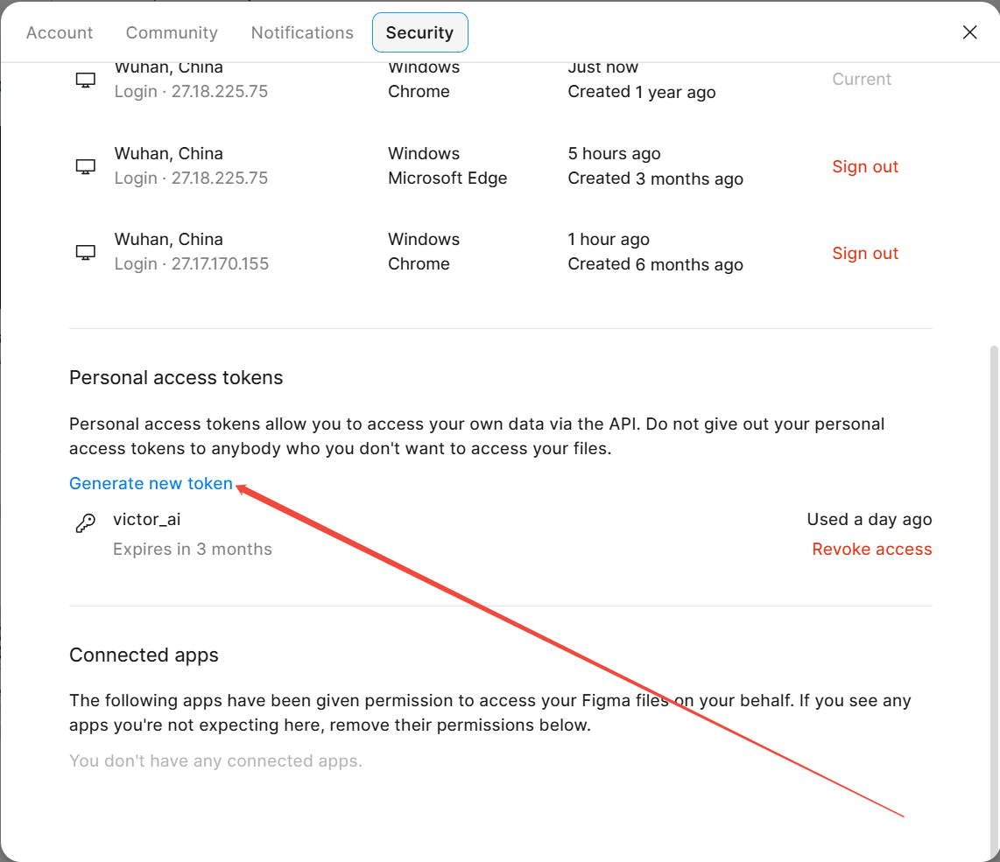

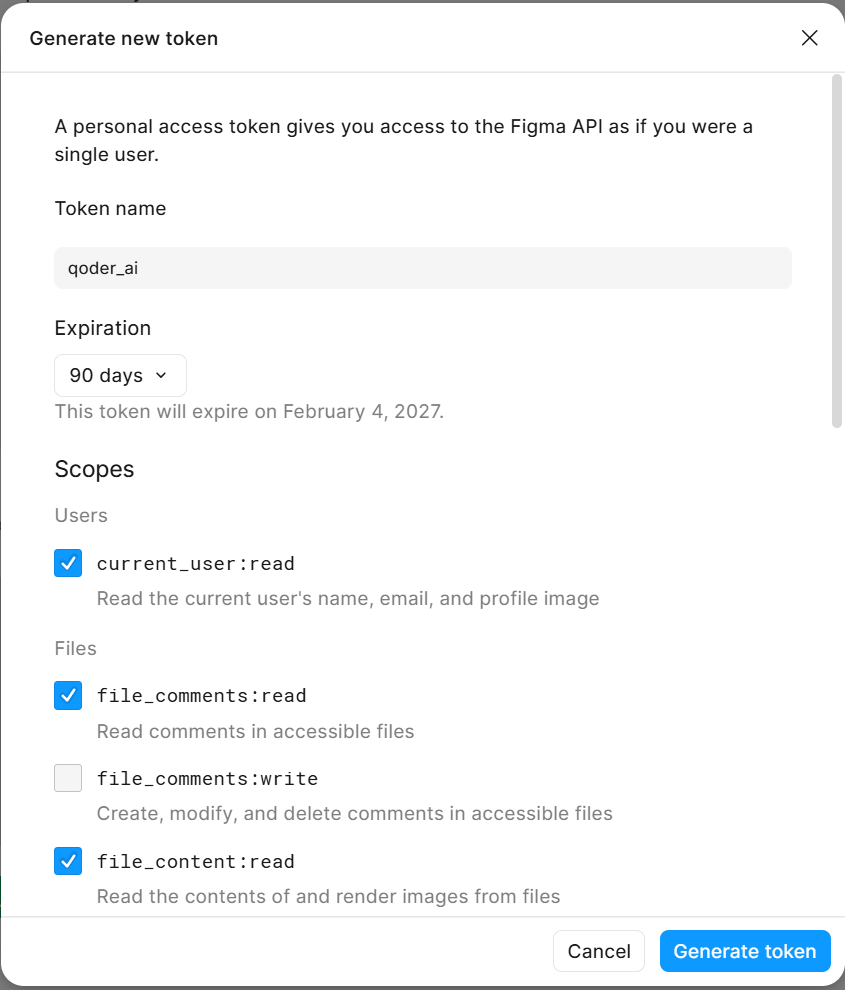

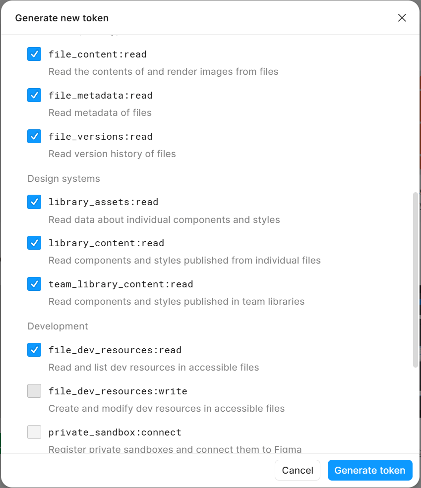

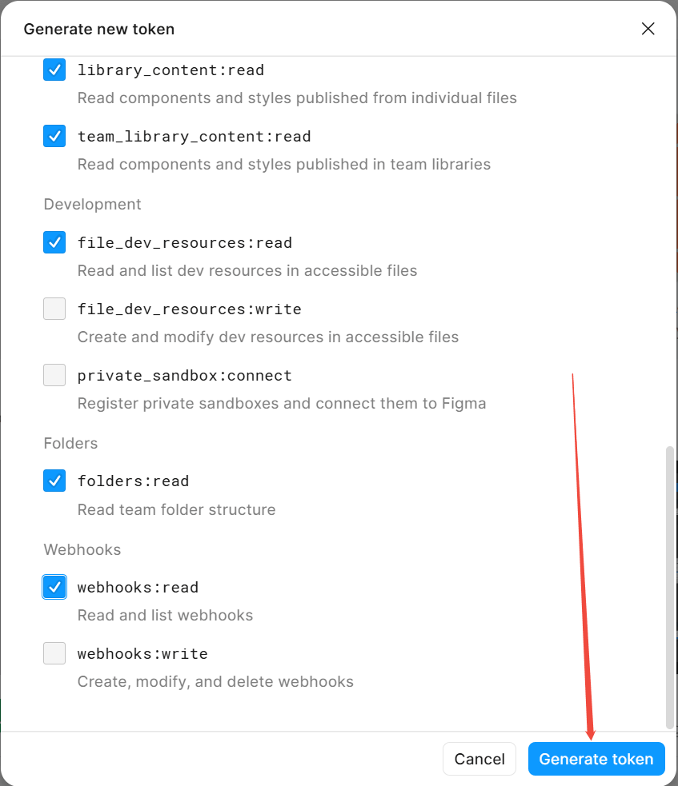

> 点击「Generate token」后立即复制并保存。为避免凭证泄露，本文档不展示包含真实 token 的截图；分享材料前也请勿使用带 token 的截图。

> 建议只授予只读权限。除非确实需要写评论或修改设计资源，不要勾选 `write` 类权限。

---

## 4. 获取 TAPD 个人访问令牌

**操作步骤**

1. 登录 TAPD。
2. 点击左下角头像。
3. 选择「我的设置」。
4. 在个人设置页面点击「个人访问令牌」。
5. 点击右上角「+ 创建个人访问令牌」。
6. 填写名称，例如 `qoder_ai`，创建后立即复制令牌。

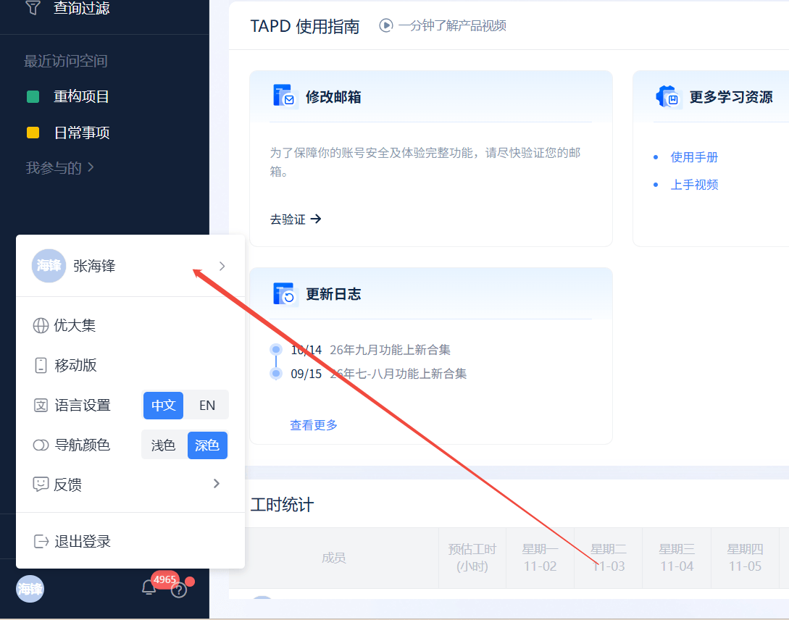

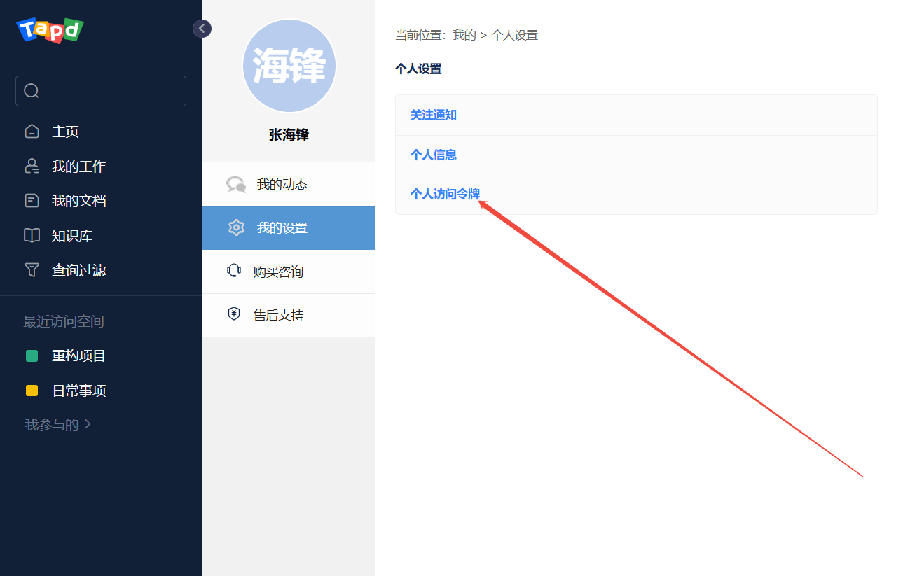

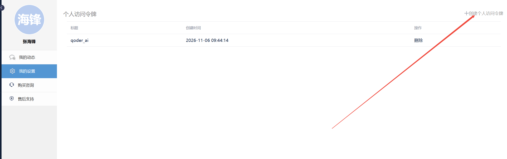

> TAPD 令牌通常只显示一次。创建后先保存到本地密码管理器，再填入 MCP 配置。

---

## 5. MCP 配置 JSON

下面是本项目的 MCP 配置模板。请把占位符替换成你自己的 token，**不要把真实值提交到仓库**。

```json
{
  "mcpServers": {
    "figma_mcp": {
      "command": "npx",
      "args": ["-y", "figma-developer-mcp", "--stdio"],
      "env": {
        "FIGMA_API_KEY": "<YOUR_FIGMA_API_KEY>"
      }
    },
    "tapd_mcp": {
      "command": "npx",
      "args": ["-y", "tapd-mcp-server"],
      "env": {
        "TAPD_ACCESS_TOKEN": "<YOUR_TAPD_ACCESS_TOKEN>"
      }
    }
  }
}
```

**字段说明**

| 字段 | 说明 |
|---|---|
| `mcpServers` | MCP 服务集合，所有客户端都使用这个结构 |
| `figma_mcp` | 服务名，建议保持与 Skill 中的工具引用一致 |
| `command` | 启动命令，这里使用 `npx` |
| `args` | `-y` 表示自动确认安装；`figma-developer-mcp --stdio` 以标准输入输出模式启动 |
| `env` | 传给 MCP 服务的环境变量，token 放在这里 |
| `tapd_mcp` | TAPD MCP 服务名 |
| `tapd-mcp-server` | TAPD MCP 的 npm 包名 |

> 如果团队需要共享配置，提交一份 `mcp.example.json`（只含占位符），真实 `mcp.json` 放在本地并加入 `.gitignore`。

**各客户端入口**

| 客户端 | 配置章节 | 配置文件 |
|---|---|---|
| Qoder CN 桌面端 | 6 | `~/.qoder-cn/settings.json` |
| Android Studio Qoder CN 插件 | 7 | `~/.qoder-cn/shared_client/mcp.json` |
| Cursor | 8 | 用户级 `~/.cursor/mcp.json`；项目级 `<项目>/.cursor/mcp.json` |
| Trae | 9 | 项目级 `<项目>/.trae/mcp.json`（需打开「启用项目级 MCP」） |

---

## 6. Qoder CN 桌面端配置

**操作步骤**

1. 打开 Qoder CN 桌面端。
2. 左侧点击「扩展」。
3. 顶部切换到「连接器」。
4. 点击右上角「添加连接器」。
5. 选择「添加自定义 MCP」。
6. 切换到「JSON」标签。
7. 粘贴第 5 节的 `mcpServers` 配置。
8. 点击「预览导入」，确认后保存。
9. 回到「扩展管理」→「连接器」，确认 `figma_mcp` 和 `tapd_mcp` 显示「可用」，并打开右侧开关。

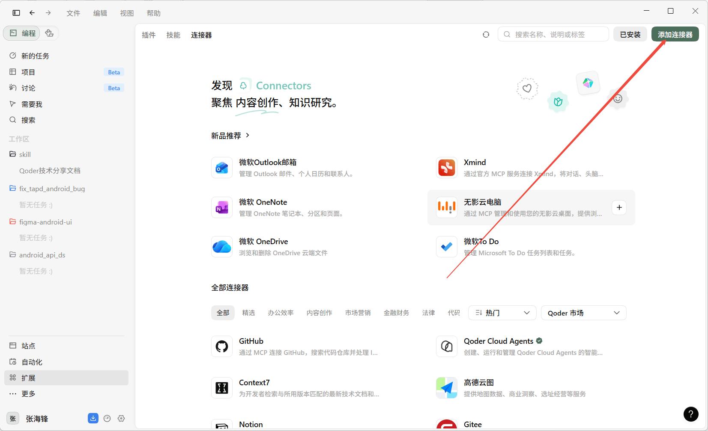

> 「添加自定义 MCP」截图中的 JSON 会包含真实 API Key，本文档不嵌入该截图。请按界面选择 JSON 标签，粘贴第 5 节的脱敏模板并填入本地 token，然后点击「预览导入」。

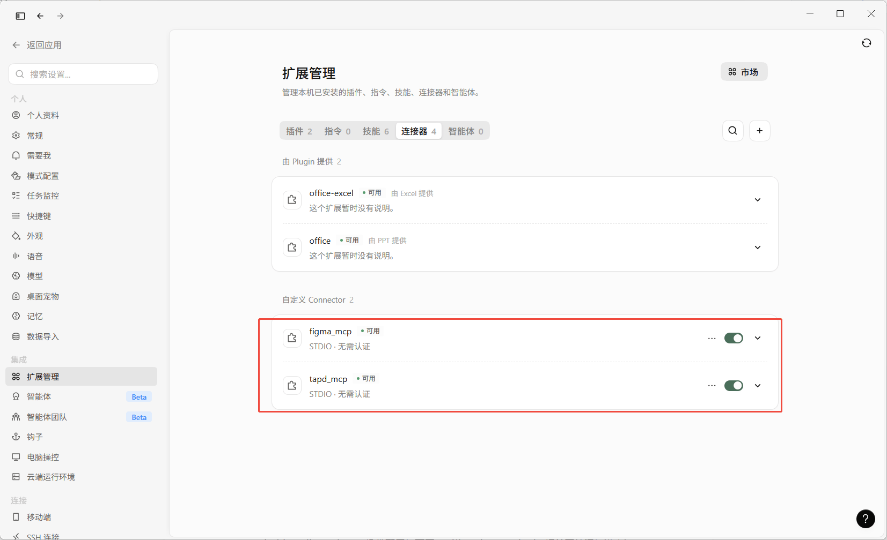

**配置文件位置**

桌面端的自定义 MCP 配置会保存到：

```
C:\Users\<用户名>\.qoder-cn\settings.json
```

其中的 `mcpServers` 字段即上面粘贴的内容。也可以直接编辑该文件，但修改后需要重启或重新加载。

---

## 7. Android Studio Qoder CN 插件配置

**操作步骤**

1. 打开 Android Studio。
2. 进入 `Settings`（Windows/Linux）或 `Preferences`（macOS）。
3. 找到 `Other Settings → Qoder CN → 个人设置 → MCP 服务器`。
4. 点击「打开」，打开配置文件：

```
C:\Users\<用户名>\.qoder-cn\shared_client\mcp.json
```

5. 把第 5 节的 `mcpServers` JSON 粘贴进去并保存。
6. 回到设置页点击「刷新」。
7. 确认 `figma_mcp` 和 `tapd_mcp` 的状态为「已连接」，并勾选「已启用」。
8. 如果状态没有变化，重启 Android Studio。

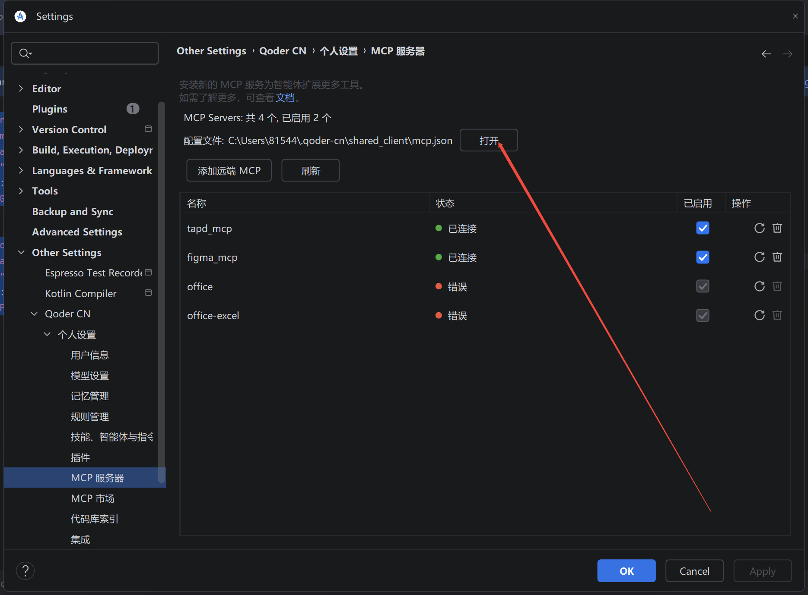

> 桌面端和 IDE 插件使用不同的配置文件：桌面端是 `~/.qoder-cn/settings.json`，插件是 `~/.qoder-cn/shared_client/mcp.json`。两端都要用，就两端都配置。

---

## 8. Cursor 配置

**操作步骤**

1. 打开 Cursor，左侧点击「Customize」。
2. 顶部切换到「MCPs」。
3. 点击「New MCP Server」，选择「Add a Custom MCP Server」。
4. 选择配置范围：`User` 为用户级，所有项目生效；`Workspaces` 或具体项目为项目级。
5. 在打开的 `mcp.json` 中粘贴第 5 节的 `mcpServers` 配置并保存。
6. 回到「Customize → MCPs」，确认 `figma_mcp`（2 个工具）和 `tapd_mcp`（18 个工具）前面的圆点为绿色。

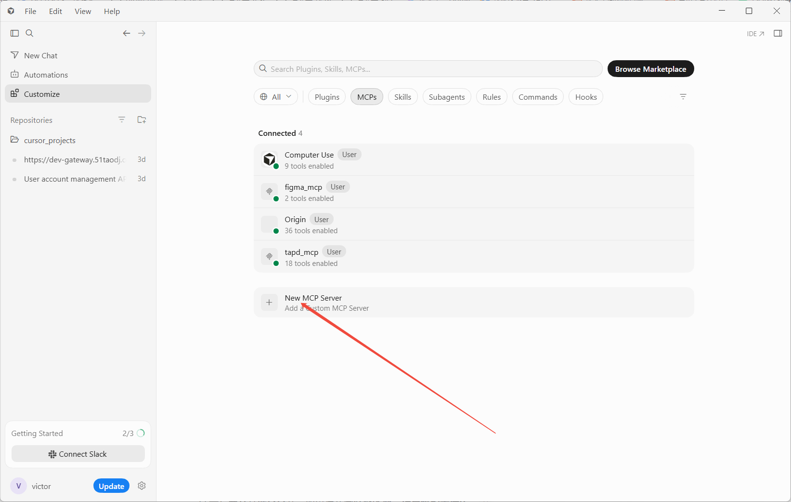

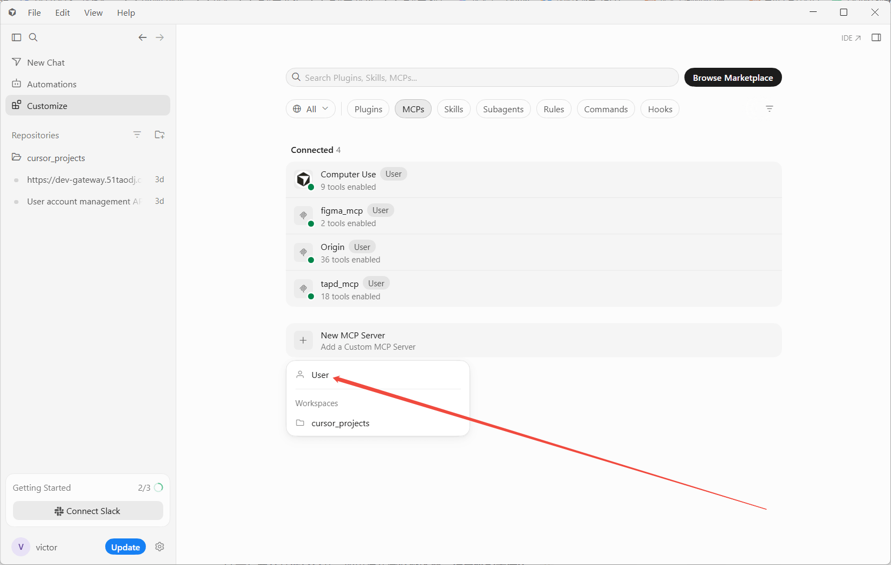

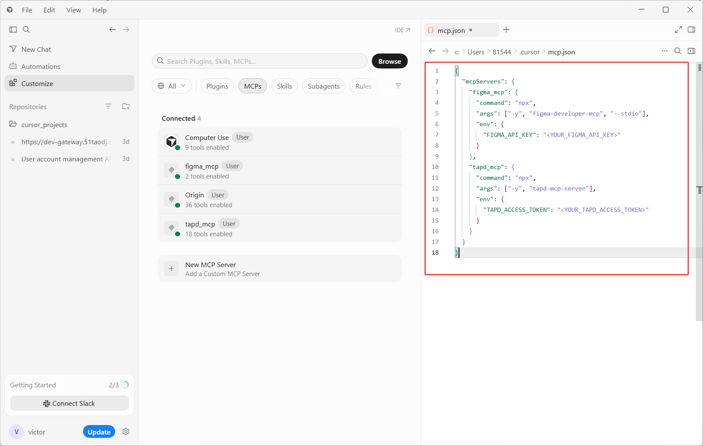

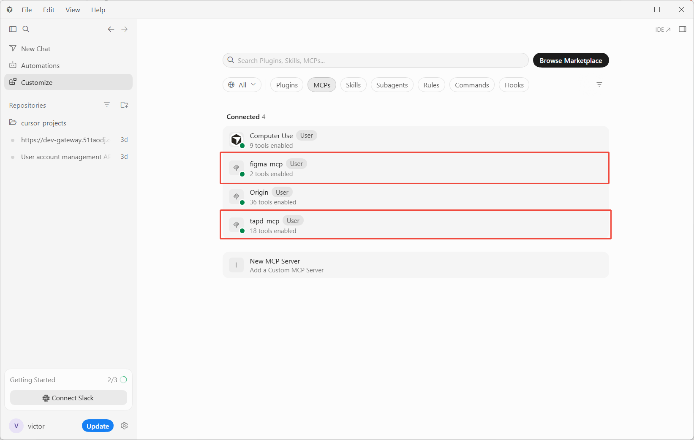

**配置文件位置**

| 级别 | 路径 |
|---|---|
| 用户级 | `C:\Users\<用户名>\.cursor\mcp.json` |
| 项目级 | `<项目根目录>\.cursor\mcp.json` |

Cursor 的配置文件顶层直接是 `mcpServers`，与第 5 节的模板结构一致，不需要额外包装。截图中的 JSON 使用脱敏占位符，实际填入本地 token。

---

## 9. Trae 配置

**操作步骤**

1. 打开 Trae，点击右上角「设置」。
2. 左侧选择「MCP」。
3. 点击「+ 添加」，选择「手动配置」。
4. 在「原始配置（JSON）」中粘贴只含 `figma_mcp` 的配置，点击「确认」。

```json
{
  "mcpServers": {
    "figma_mcp": {
      "command": "npx",
      "args": ["-y", "figma-developer-mcp", "--stdio"],
      "env": {
        "FIGMA_API_KEY": "<YOUR_FIGMA_API_KEY>"
      }
    }
  }
}
```

5. 再次点击「+ 添加 → 手动配置」，粘贴只含 `tapd_mcp` 的配置并确认。

```json
{
  "mcpServers": {
    "tapd_mcp": {
      "command": "npx",
      "args": ["-y", "tapd-mcp-server"],
      "env": {
        "TAPD_ACCESS_TOKEN": "<YOUR_TAPD_ACCESS_TOKEN>"
      }
    }
  }
}
```

6. 回到 MCP 列表，确认 `tapd_mcp`、`figma_mcp` 后出现对勾，右侧开关为打开状态。

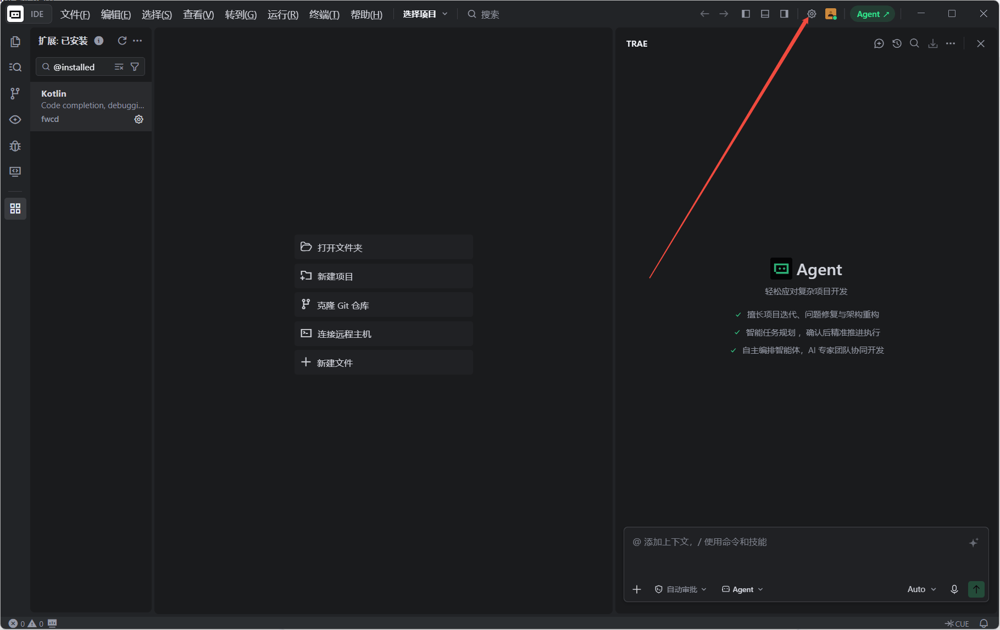

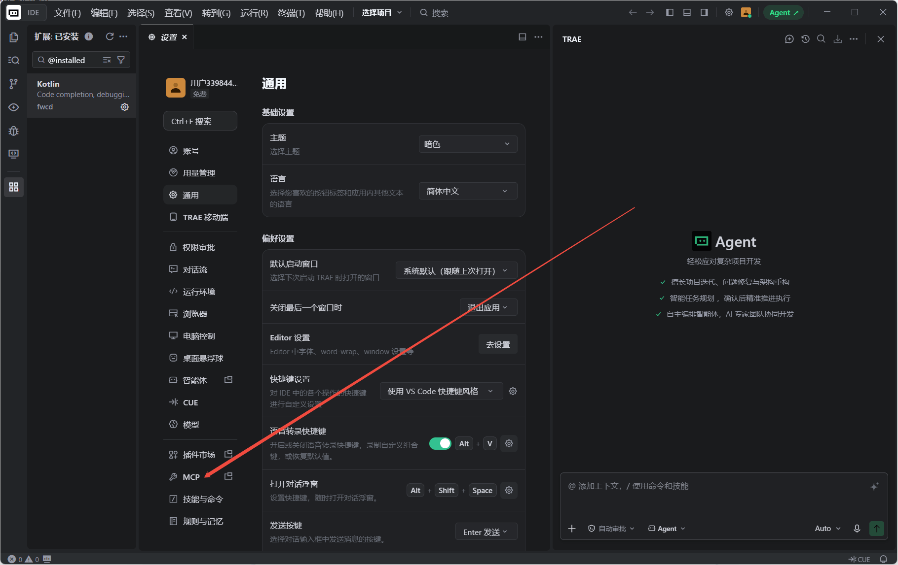

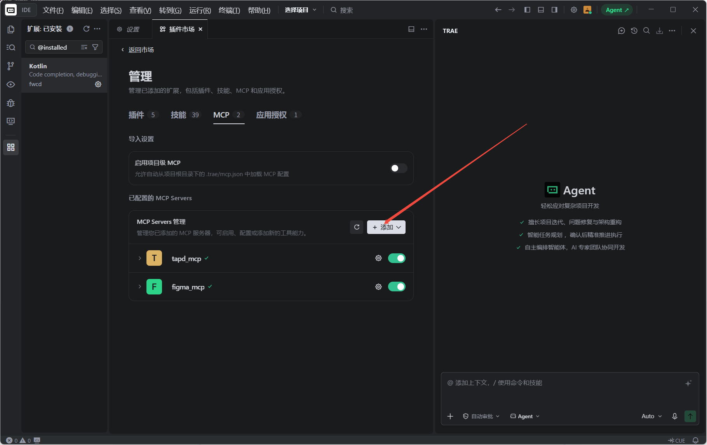

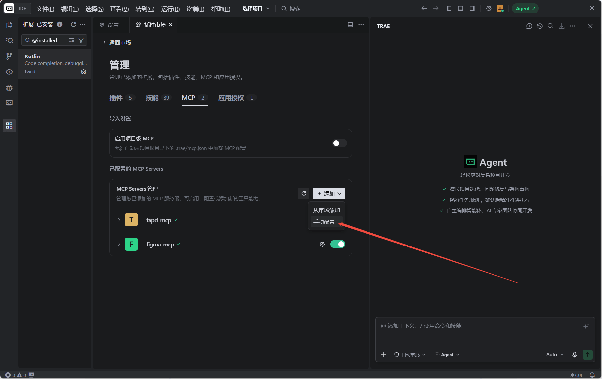

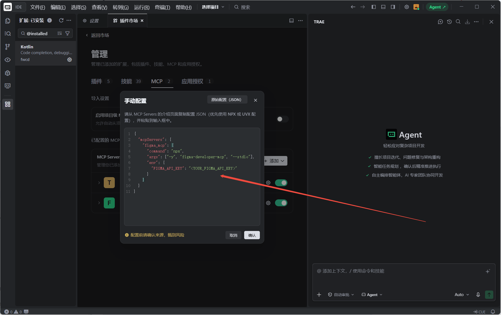

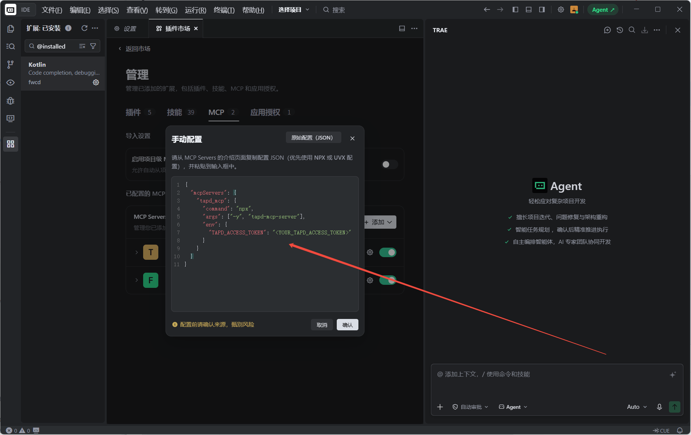

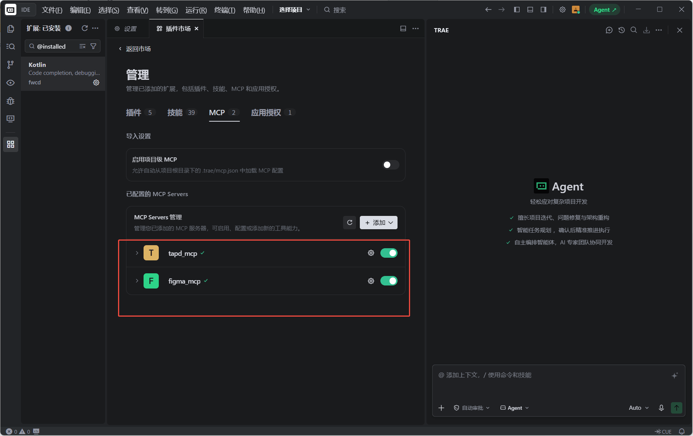

**配置文件位置**

| 级别 | 方式 |
|---|---|
| 用户级 | 通过「手动配置」弹窗添加，按客户端实际保存位置为准 |
| 项目级 | `<项目根目录>\.trae\mcp.json`，并在 MCP 设置中打开「启用项目级 MCP」 |

> Trae 的手动配置一次只添加一个服务，两个服务要分别添加两次。项目级配置需要手动打开「启用项目级 MCP」开关，否则 `.trae/mcp.json` 不会生效。

---

## 10. 验证 MCP

**Qoder 桌面端验证**

1. 「扩展管理 → 连接器」中两个服务显示「可用」。
2. 新建任务，输入：「调用 `tapd_list_workspaces`，列出我有权限的项目空间。」
3. 能返回项目列表，说明 TAPD MCP 正常。
4. 输入：「使用 `figma_mcp` 读取这个设计稿的节点信息：<链接>。」
5. 能返回节点树，说明 Figma MCP 正常。

**Qoder IDE 插件验证**

1. `Settings → Other Settings → Qoder CN → 个人设置 → MCP 服务器` 中状态为「已连接」。
2. 在 Qoder 对话中调用 `tapd_list_workspaces` 或读取 Figma 节点。
3. 如果显示未连接，先点「刷新」，再重启 IDE。

**Cursor 验证**

1. `Customize → MCPs` 中 `figma_mcp` 显示 2 tools enabled、`tapd_mcp` 显示 18 tools enabled，圆点为绿色。
2. 在对话中调用 `tapd_list_workspaces`，能返回项目列表。
3. 工具数为 0 或圆点变红时，检查 `mcp.json` 的 JSON 格式和 token，保存后重新加载窗口。

**Trae 验证**

1. `设置 → MCP` 中 `tapd_mcp`、`figma_mcp` 后显示对勾，右侧开关为打开状态。
2. 在对话中调用 `tapd_list_workspaces`，能返回项目列表。
3. 项目级配置不生效时，确认设置页「启用项目级 MCP」开关已打开，且 `<项目根目录>\.trae\mcp.json` 存在。

**终端验证**

```bash
node -v
npx -v

# 检查 npm 包能否拉取并启动；启动后按 Ctrl+C 退出
npx -y tapd-mcp-server
npx -y figma-developer-mcp --stdio
```

首次执行会下载 npm 包，需要网络。如果命令能启动并输出日志，说明运行环境正常；如果报错，先解决 Node/npm 问题。

**常见状态**

| 状态 | 含义 | 处理 |
|---|---|---|
| 可用 / 已连接 | MCP 启动成功 | 可以开始使用 |
| 错误 / 未连接 | 启动失败或 token 无效 | 查看日志，检查 `npx`、网络、token |
| 一直加载 | 首次下载依赖或网络慢 | 等待或改用国内 npm 源 |
| 工具列表为空 | 服务启动但未暴露工具 | 检查包名和启动参数 |

**常见问题**

| 现象 | 可能原因 | 处理 |
|---|---|---|
| 状态显示「错误」 | `npx` 不存在、包下载失败、token 无效 | 终端执行 `node -v`、`npx -v`，再手动运行 MCP 命令 |
| 状态一直加载 | 首次下载依赖或网络慢 | 等待，或切换 npm 源 |
| Figma 返回 401/403 | token 失效、权限不足、无文件访问权限 | 重新生成 token，确认勾选 `file_content:read`，确认账号有文件权限 |
| TAPD 返回 401 | 令牌失效或复制不完整 | 重新创建个人访问令牌 |
| 桌面端可用、IDE 不可用 | 两端配置文件不同 | 分别配置 `settings.json` 和 `shared_client/mcp.json` |
| 工具列表为空 | 包名或启动参数错误 | 核对 `figma-developer-mcp --stdio` 和 `tapd-mcp-server` |

---

## 11. 凭证安全

1. **不要提交真实 token**：含 `FIGMA_API_KEY`、`TAPD_ACCESS_TOKEN` 的 `mcp.json` 只放在本地，加入 `.gitignore`。
2. **及时轮换凭证**：如果 token 出现在聊天、截图、公开文档或代码仓库中，立即撤销并重新生成。
3. **最小权限**：Figma token 只授予只读权限；TAPD 使用个人访问令牌，不要使用管理员账号的长期凭证。
4. **截图脱敏**：分享配置截图时，遮挡 token、workspace ID、Bug ID、项目路径中的敏感信息。

---

## 12. 图片路径说明

本文档中的图片使用相对路径 `images/xxx.png`。请保持 Markdown 文件与 `images` 目录在同一级：

```
<文档目录>/
├── Android-AI-Coder-落地.md
├── SKILL-MCP-COMMAND配置指南.md
└── images/
    ├── api_key/
    │   ├── figma/        # figma_1.png ~ figma_5.png
    │   └── tapd/         # tapd_1.png ~ tapd_3.png
    └── mcp/
        ├── qoder_mcp/    # qoder_cn_desktop_mcp_1/3.png、qoder_cn_ide_plugin_mcp.png
        ├── cursor_mcp/   # cursor1.png ~ cursor4.png
        └── trae_mcp/     # trae1.png ~ trae7.png
```

如果移动了文档，需要同步调整图片路径。

---

## 13. 版本记录

| 版本 | 日期 | 说明 |
|---|---|---|
| v1.8 | 2026-11-13 | Skill 配置扩为七个：新增 `android-naming`、`android-module`、`android-project`、`android-build-logic` 的目录、安装、适配与验证；命名规则收敛到 `android-naming` |
| v1.9 | 2026-11-13 | 与落地文档 v1.15、14 页技术分享 PPT 对齐：1.4 补七个 Skill 的触发语句对照表，1.5 补其余命名文件的适配项，第 2 节补三个命令的分工与 `/android-create-project` 五阶段门槛，新增版本记录 |
