# Android 项目使用 Qoder Code 落地文档

> 适用对象：Android 客户端开发、测试、技术负责人
>
> 覆盖范围：Qoder CN 桌面端 + Android Studio Qoder CN 插件；MCP 配置、Skill 安装、三个 Skill 的落地流程、效率分析与质量验收
>
> 版本：v1.1 ｜ 日期：2026-11-06

---

## 0. 落地目标与前置条件

### 0.1 最终目标

让 Qoder 在 Android 项目中具备三项能力：

1. **读设计稿**：通过 Figma MCP 读取设计结构和图片，生成符合项目规范的 XML 与页面代码。
2. **读缺陷单**：通过 TAPD MCP 读取 Bug 详情、评论和流转记录，分析根因并修复。
3. **按项目规范产出**：通过三个 Skill 约束目录结构、命名、分层、资源位置和验收标准。

### 0.2 先区分 MCP 与 Skill

| 概念 | 作用 | 本项目的例子 |
|---|---|---|
| MCP | 给 AI 提供工具和数据通道 | Figma MCP 读取设计稿；TAPD MCP 读取 Bug |
| Skill | 给 AI 提供流程、规范和检查清单 | 设计稿怎么转 XML、接口链路怎么分层、Bug 怎么定位 |

两者缺一不可：只有 MCP，AI 能读到数据但不知道项目规范；只有 Skill，AI 知道规范但读不到 Figma/TAPD。

### 0.3 三个 Skill 一页速览

| Skill | 解决什么问题 | 输入 | 主要产出 | 覆盖阶段 |
|---|---|---|---|---|
| `figma-android-ui` | 设计稿到 XML 布局的重复还原与命名不统一 | Figma / MasterGo / 即时设计 / 蓝湖 / Sketch / XD / PS 链接或截图 | XML 布局、Activity/Fragment 代码、资源命名与切图清单 | UI 开发 |
| `android_api_ds` | 一个接口要写 8~9 个文件，容易漏层、漏字段 | Swagger / Knife4j 文档链接或截图 | Req、Data、Api、ApiService、IDS、DS、VM、VMFactory、InjectorUtils | 接口联调 |
| `fix_tapd_android_bug` | Bug 上下文分散，描述与评论不一致，修复易漏文案 | TAPD Bug 链接或 Bug ID | 根因分析、修复方案、代码修改 | 提测与缺陷修复 |

**一句话结论**：这三个 Skill 不是让 AI 随便写代码，而是把团队已有的目录结构、命名规范、分层方式和检查清单变成 AI 可执行的约束，让产出直接接近可提交状态，减少返工和 Review 轮次。

**它们不覆盖**：需求评审、服务端开发、自动化测试、发布上线。

### 0.4 为什么要把流程做成 Skill

Android 日常开发中，真正耗时的往往不是写业务逻辑，而是下面四类工作：

| 痛点 | 具体表现 | 结果 |
|---|---|---|
| 信息跨系统搬运 | 设计在 Figma、接口在 Swagger、缺陷在 TAPD，反复切换和截图 | 上下文准备时间长 |
| 规范靠记忆和 Review 兜底 | 控件 ID、颜色、布局文件、类名、LiveData 命名各有规则 | 首轮 PR 问题多，返工 |
| 样板代码占比高 | 一个接口要新增请求类、响应类、路径常量、Service、DS、VM、Factory、注入入口 | 机械劳动多，容易漏层 |
| 问题定位依赖个人经验 | Bug 描述不准确，关键结论埋在评论里 | 定位慢，修复范围不确定 |

Skill 的本质，是把「输入格式 + 执行步骤 + 规范约束 + 检查清单」固化成一份可复用、可版本化的指令：

```
口头经验 / 团队规范
        ↓ 固化
Skill（SKILL.md + references）
        ↓ 执行
按统一标准产出的代码与文档
```

它带来的不是单次写得更快，而是**同一类任务每次都能按同一标准完成**。

> AI 可以加速生成，但不能替代业务判断、代码审查和测试验证。效率提升必须建立在质量达标之上。

### 0.5 前置条件

| 项目 | 要求 |
|---|---|
| Node.js | 已安装 Node.js 18+，终端可执行 `node -v` 和 `npx -v` |
| Qoder CN 桌面端 | 已安装并登录，可访问「扩展 → 连接器」 |
| Android Studio | 已安装 Qoder CN 插件并登录 |
| Android 工程 | Kotlin + Retrofit + MVVM，具备基础库和业务模块结构 |
| Figma | 有目标设计稿的访问权限 |
| TAPD | 有目标项目空间和 Bug 的访问权限 |
| 编译环境 | 本地能正常执行 Gradle 构建，便于生成后验证 |
| 网络 | 能访问 npm 源、Figma API、TAPD API |

**技术栈前提**

| 维度 | 要求 |
|---|---|
| 语言 | Kotlin |
| 网络 | Retrofit2 + OkHttp3 + Gson |
| 异步 | Kotlin Coroutines |
| 架构 | MVVM + LiveData |
| 视图绑定 | ViewBinding |
| 依赖注入 | 手动注入：`InjectorUtils + VMFactory`（非 Hilt/Koin） |
| 组件化 | 基础库 + 业务模块的多模块结构 |
| 路由/事件 | ARouter、FlowEventBus（`architecture-spec` 中有约定） |

如果项目使用 Hilt、Koin、Compose、MVI 或单模块结构，需要先调整 references 中的模板，不能直接套用。

**设计与数据前提**

| 类型 | 前提 |
|---|---|
| 设计稿 | 建议 750px 宽、3x；图层结构清晰；可访问 Figma 文件 |
| 截图输入 | 可生成布局，但尺寸和颜色精度低于设计稿链接，必须人工校准 |
| 接口文档 | 字段名、类型、必填、说明尽可能完整；缺失时需补充业务语义 |
| 缺陷单 | 评论中有开发/测试的排查结论时效果最好；无评论时需人工确认根因 |

> **安全提醒**：MCP 配置中包含 Figma API Key 和 TAPD 个人访问令牌，属于个人凭证。本文档只使用占位符，**不要把真实 token 提交到 Git、聊天群或公开文档**。如果 token 已经公开，请立即到 Figma/TAPD 后台撤销并重新生成。

---

## 1. 总体接入流程

### 1.1 接入步骤

```
安装 Node.js / 确认 npx
        ↓
获取 Figma API Key 和 TAPD 个人访问令牌
        ↓
配置 MCP（桌面端 + Android Studio 插件）
        ↓
验证 MCP 连接
        ↓
安装三个 Skill
        ↓
完成项目架构认知
        ↓
按「页面 → 接口 → Bug」试点
        ↓
质量验收后团队推广
```

### 1.2 阶段与产出

| 阶段 | 预计时间 | 产出 |
|---|---|---|
| 环境准备 | 0.5 天 | Node、Qoder、Android Studio 可用 |
| 凭证与 MCP | 0.5 天 | 两个 MCP 显示「可用 / 已连接」 |
| Skill 安装 | 10 分钟 | 三个 Skill 出现在技能列表 |
| 项目认知 | 0.5~1 天 | 模块职责、分层、资源归属说明 |
| 试点 | 1 周 | 1 个页面、1 个接口、1 个 Bug 的完整记录 |
| 推广 | 持续 | 团队使用规范与质量度量 |

### 1.3 三个 Skill 的全景定位

三个 Skill 分别卡在研发链路的三段高频环节：

```
需求评审 → 设计 → UI 开发 → 接口联调 → 提测 → 缺陷修复 → 回归
                     │           │                    │
                     │           │                    └── fix_tapd_android_bug
                     │           └── android_api_ds
                     └── figma-android-ui
```

| 链路环节 | Skill | 触发方式 | 人的角色 |
|---|---|---|---|
| UI 开发 | `figma-android-ui` | 提供设计稿链接或截图，说「生成页面 / 转 XML」 | 确认模块、走查还原度 |
| 接口联调 | `android_api_ds` | 提供 Swagger/Knife4j 文档，说「对接接口 / 生成请求代码」 | 确认字段语义、业务分支 |
| 缺陷修复 | `fix_tapd_android_bug` | 提供 TAPD 链接，说「修复这个 Bug」 | 确认根因、验收修复 |

三个 Skill 共用同一套项目规范（MVVM、组件化目录、命名规则），因此可以串起来使用。

---

## 2. 配置 MCP

### 2.1 获取 Figma API Key

Figma MCP 需要个人访问令牌（Personal Access Token）才能读取设计文件。

**操作步骤**

1. 登录 Figma，点击左上角头像。
2. 选择「Settings」。
3. 切换到「Security」标签。
4. 在「Personal access tokens」区域点击「Generate new token」。
5. 填写 Token 名称，例如 `qoder_ai`；选择有效期，例如 90 天。
6. 勾选只读权限。至少需要：
   - `current_user:read`
   - `file_content:read`
   - `file_metadata:read`
   - `file_versions:read`
   - `library_assets:read`
   - `library_content:read`
   - `team_library_content:read`
   - `file_dev_resources:read`
   - `folders:read`
   - 如需读取评论，再勾选 `file_comments:read`
7. 点击「Generate token」。
8. **立即复制 token**，页面关闭后无法再次查看。

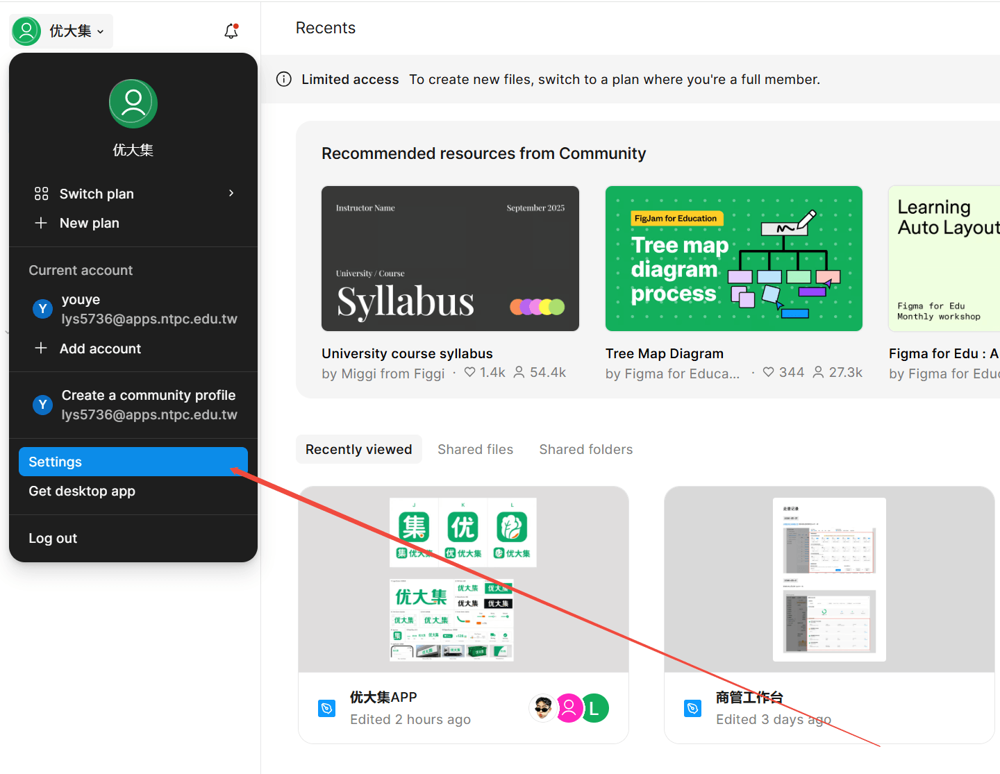

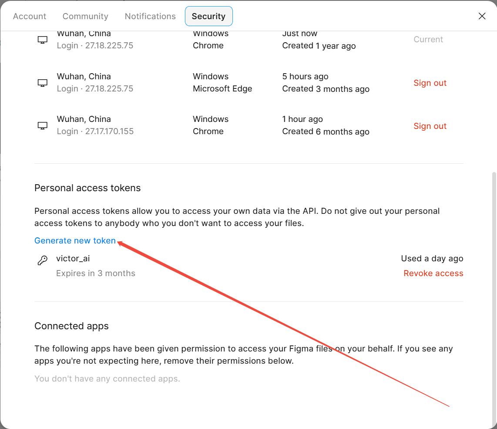

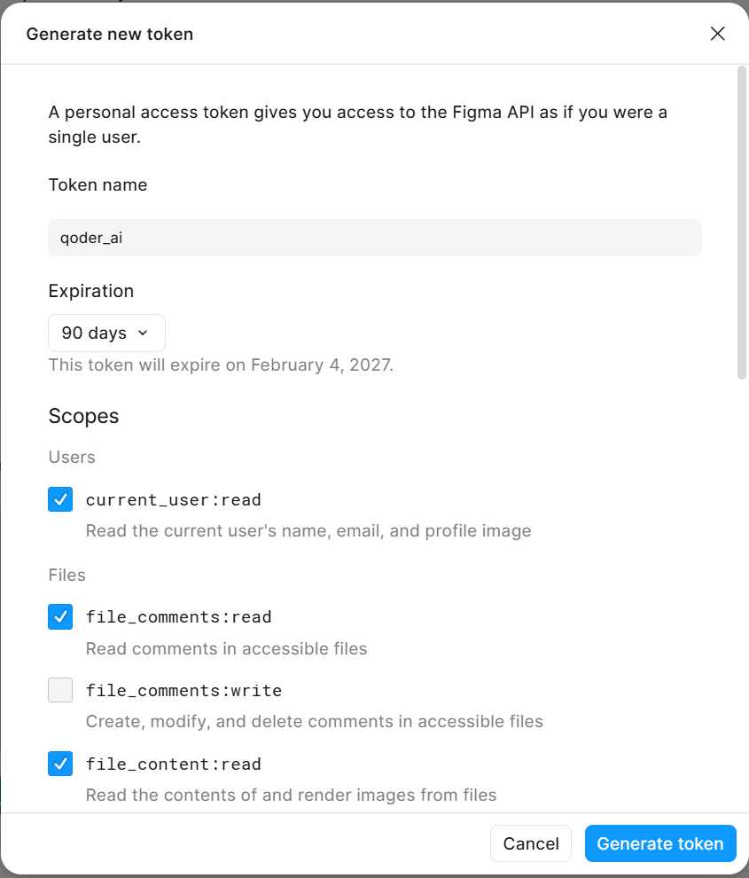

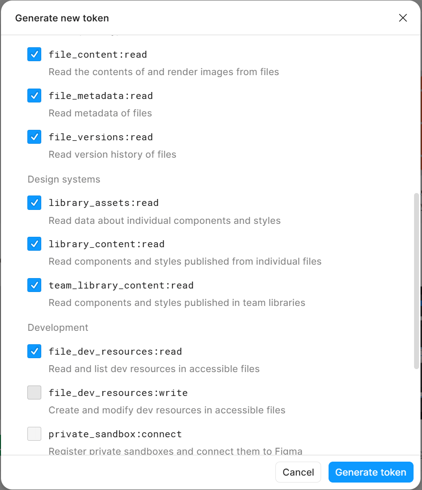

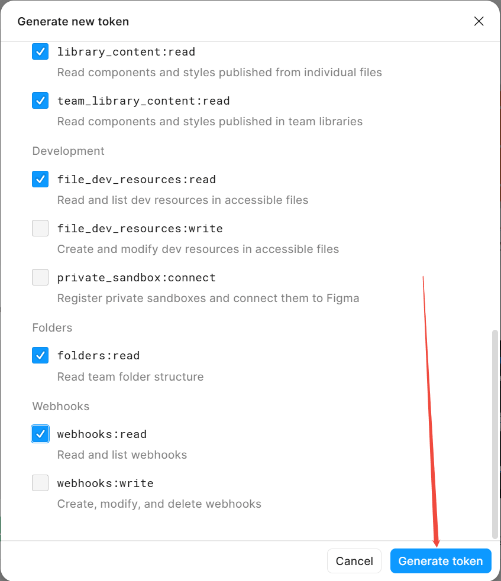

> 点击「Generate token」后立即复制并保存。为避免凭证泄露，本文档不展示包含真实 token 的截图；分享材料前也请勿使用带 token 的截图。

> 建议只授予只读权限。除非确实需要写评论或修改设计资源，不要勾选 `write` 类权限。

---

### 2.2 获取 TAPD 个人访问令牌

**操作步骤**

1. 登录 TAPD。
2. 点击左下角头像。
3. 选择「我的设置」。
4. 在个人设置页面点击「个人访问令牌」。
5. 点击右上角「+ 创建个人访问令牌」。
6. 填写名称，例如 `qoder_ai`，创建后立即复制令牌。

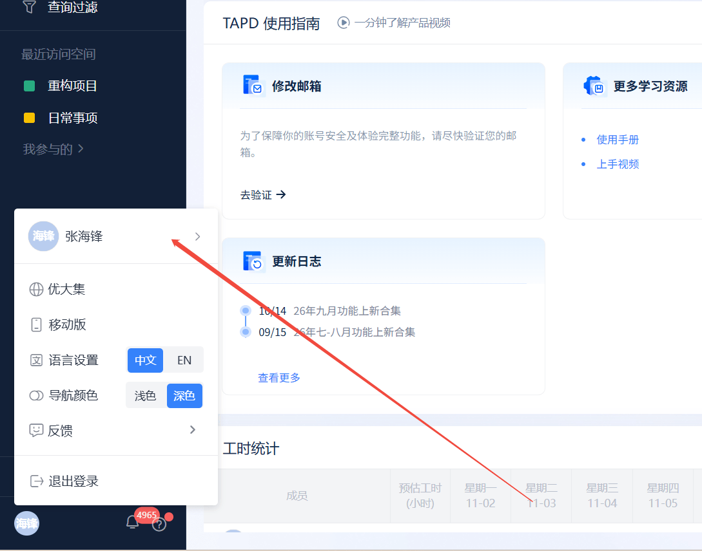

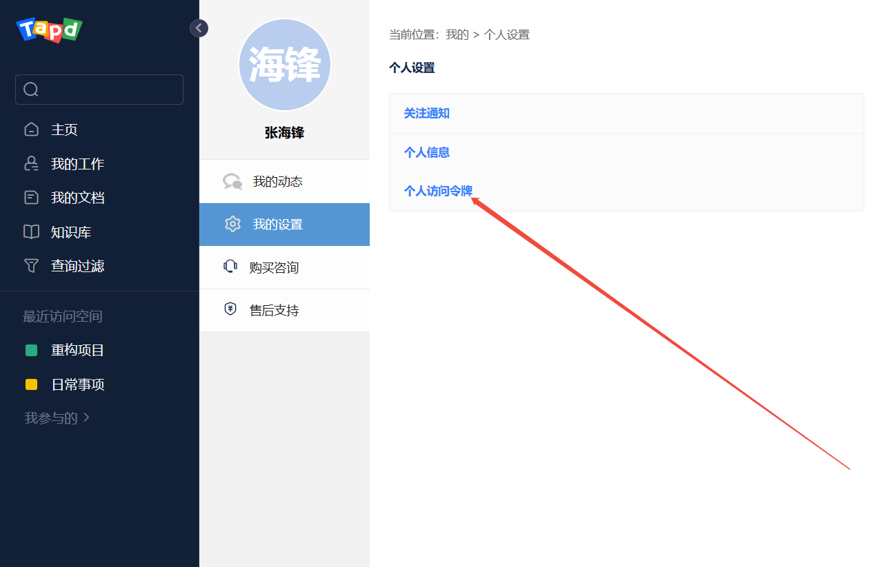

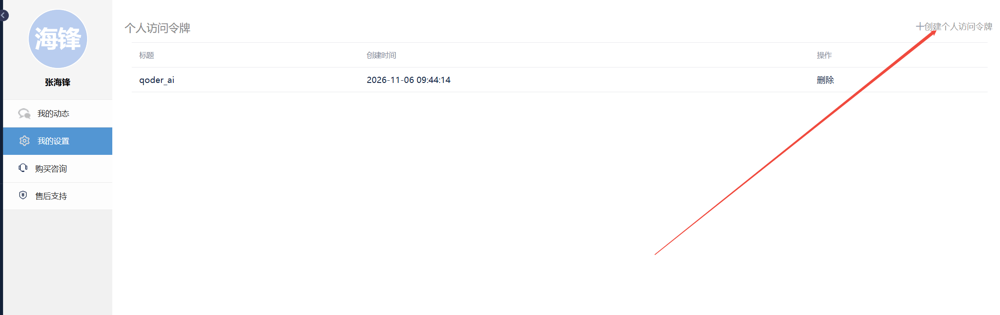

> TAPD 令牌通常只显示一次。创建后先保存到本地密码管理器，再填入 MCP 配置。

---

### 2.3 MCP 配置 JSON

下面是本项目的 MCP 配置模板。请把占位符替换成你自己的 token，**不要把真实值提交到仓库**。

```json
{
  "mcpServers": {
    "figma_mcp": {
      "command": "npx",
      "args": ["-y", "figma-developer-mcp", "--stdio"],
      "env": {
        "FIGMA_API_KEY": "<YOUR_FIGMA_API_KEY>"
      }
    },
    "tapd_mcp": {
      "command": "npx",
      "args": ["-y", "tapd-mcp-server"],
      "env": {
        "TAPD_ACCESS_TOKEN": "<YOUR_TAPD_ACCESS_TOKEN>"
      }
    }
  }
}
```

**字段说明**

| 字段 | 说明 |
|---|---|
| `mcpServers` | MCP 服务集合，桌面端和插件都使用这个结构 |
| `figma_mcp` | 服务名，建议保持与 Skill 中的工具引用一致 |
| `command` | 启动命令，这里使用 `npx` |
| `args` | `-y` 表示自动确认安装；`figma-developer-mcp --stdio` 以标准输入输出模式启动 |
| `env` | 传给 MCP 服务的环境变量，token 放在这里 |
| `tapd_mcp` | TAPD MCP 服务名 |
| `tapd-mcp-server` | TAPD MCP 的 npm 包名 |

> 如果团队需要共享配置，提交一份 `mcp.example.json`（只含占位符），真实 `mcp.json` 放在本地并加入 `.gitignore`。

---

### 2.4 Qoder CN 桌面端配置

**操作步骤**

1. 打开 Qoder CN 桌面端。
2. 左侧点击「扩展」。
3. 顶部切换到「连接器」。
4. 点击右上角「添加连接器」。
5. 选择「添加自定义 MCP」。
6. 切换到「JSON」标签。
7. 粘贴上面的 `mcpServers` 配置。
8. 点击「预览导入」，确认后保存。
9. 回到「扩展管理」→「连接器」，确认 `figma_mcp` 和 `tapd_mcp` 显示「可用」，并打开右侧开关。

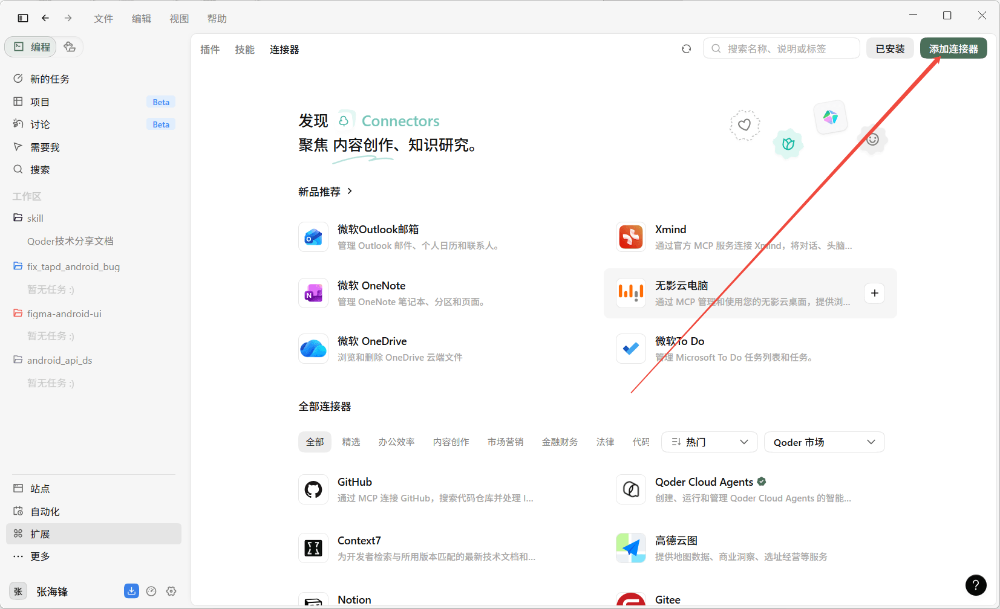

> 「添加自定义 MCP」截图中的 JSON 会包含真实 API Key，本文档不嵌入该截图。请按界面选择 JSON 标签，粘贴第 2.3 节的脱敏模板并填入本地 token，然后点击「预览导入」。

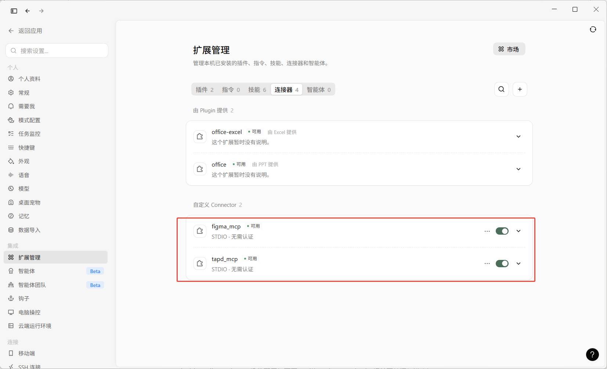

**配置文件位置**

桌面端的自定义 MCP 配置会保存到：

```
C:\Users\<用户名>\.qoder-cn\settings.json
```

其中的 `mcpServers` 字段即上面粘贴的内容。也可以直接编辑该文件，但修改后需要重启或重新加载。

---

### 2.5 Android Studio Qoder CN 插件配置

**操作步骤**

1. 打开 Android Studio。
2. 进入 `Settings`（Windows/Linux）或 `Preferences`（macOS）。
3. 找到 `Other Settings → Qoder CN → 个人设置 → MCP 服务器`。
4. 点击「打开」，打开配置文件：

```
C:\Users\<用户名>\.qoder-cn\shared_client\mcp.json
```

5. 把上面的 `mcpServers` JSON 粘贴进去并保存。
6. 回到设置页点击「刷新」。
7. 确认 `figma_mcp` 和 `tapd_mcp` 的状态为「已连接」，并勾选「已启用」。
8. 如果状态没有变化，重启 Android Studio。

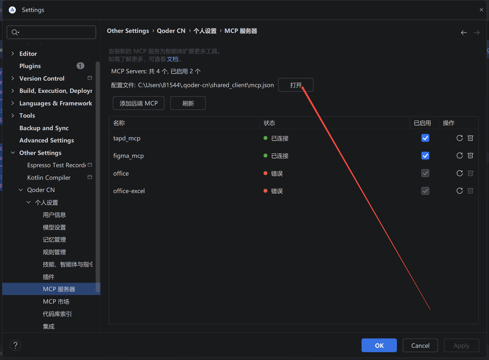

> 桌面端和 IDE 插件可能使用不同的配置文件：桌面端是 `~/.qoder-cn/settings.json`，插件是 `~/.qoder-cn/shared_client/mcp.json`。两端都要用，就两端都配置。

---

### 2.6 验证 MCP

**桌面端验证**

1. 「扩展管理 → 连接器」中两个服务显示「可用」。
2. 新建任务，输入：「调用 `tapd_list_workspaces`，列出我有权限的项目空间。」
3. 能返回项目列表，说明 TAPD MCP 正常。
4. 输入：「使用 `figma_mcp` 读取这个设计稿的节点信息：<链接>。」
5. 能返回节点树，说明 Figma MCP 正常。

**IDE 插件验证**

1. `Settings → Other Settings → Qoder CN → 个人设置 → MCP 服务器` 中状态为「已连接」。
2. 在 Qoder 对话中调用 `tapd_list_workspaces` 或读取 Figma 节点。
3. 如果显示未连接，先点「刷新」，再重启 IDE。

**终端验证**

```bash
node -v
npx -v

# 检查 npm 包能否拉取并启动；启动后按 Ctrl+C 退出
npx -y tapd-mcp-server
npx -y figma-developer-mcp --stdio
```

首次执行会下载 npm 包，需要网络。如果命令能启动并输出日志，说明运行环境正常；如果报错，先解决 Node/npm 问题。

**常见状态**

| 状态 | 含义 | 处理 |
|---|---|---|
| 可用 / 已连接 | MCP 启动成功 | 可以开始使用 |
| 错误 / 未连接 | 启动失败或 token 无效 | 查看日志，检查 `npx`、网络、token |
| 一直加载 | 首次下载依赖或网络慢 | 等待或改用国内 npm 源 |
| 工具列表为空 | 服务启动但未暴露工具 | 检查包名和启动参数 |

---

## 3. 添加 Skill

### 3.1 安装位置

Skill 支持用户级和项目级两种安装方式：

| 级别 | 路径 | 适用场景 |
|---|---|---|
| 用户级 | `C:\Users\<用户名>\.qoder-cn\skills\` | 个人使用，所有项目可用 |
| 项目级 | `<项目根目录>\.qoder\skills\` | 团队共享，跟随仓库版本管理 |

推荐：

- 个人日常开发使用用户级。
- 团队统一规范使用项目级，把 `.qoder/skills/` 提交到仓库，保证所有人使用同一版本。

### 3.2 目录结构

把三个 Skill 文件夹放到 skills 目录下：

```
skills/
├── figma-android-ui/
│   ├── SKILL.md
│   └── references/
│       ├── class-naming.md
│       ├── variable-naming.md
│       ├── ...
│       └── architecture-spec.md
├── android_api_ds/
│   ├── SKILL.md
│   ├── README.md
│   └── references/
│       ├── naming-spec.md
│       └── code-templates.md
└── fix_tapd_android_bug/
    └── SKILL.md
```

要求：

- 每个 Skill 必须有 `SKILL.md`。
- `SKILL.md` 的 frontmatter `name` 建议与文件夹名一致。
- `android_api_ds` 的 frontmatter 已改为 `name: android_api_ds`，不要改回旧名称。
- `references/` 中的规范文件保持单一职责，不要把命名、布局、代码风格混在一个文件里。

### 3.3 安装与加载

**方式一：手动复制**

```text
把 figma-android-ui、android_api_ds、fix_tapd_android_bug 三个文件夹
复制到 C:\Users\<用户名>\.qoder-cn\skills\
```

**方式二：项目级安装**

```text
在项目根目录创建 .qoder\skills\
把三个 Skill 文件夹复制进去
```

**加载**

- 桌面端：重新打开 Qoder，或在对话中执行 `/skills reload`。
- IDE 插件：重启 Android Studio，或执行 `/skills reload`。
- 查看列表：`/skills list`。

### 3.4 验证 Skill 是否生效

| 客户端 | 查看位置 |
|---|---|
| Qoder CN 桌面端 | 左侧「扩展」→「扩展管理」→「技能」标签 |
| Android Studio 插件 | `Settings → Other Settings → Qoder CN → 技能、智能体与指令` |
| 对话 | `/skills list` |

验证方式：

1. 三个 Skill 都出现在列表中。
2. 输入触发语句，例如「根据这个 Swagger 文档生成网络请求代码」，Qoder 能识别并调用 `android_api_ds`。
3. 如果没识别，检查文件夹层级是否多套了一层，例如 `skills/android_api_ds/android_api_ds/SKILL.md` 是错误结构。

### 3.5 Skill 与项目的适配

三个 Skill 内置的是参考项目的规范。换到新项目时，先确认并调整：

| 文件 | 需要确认的内容 |
|---|---|
| `android_api_ds/references/code-templates.md` | 基类名、包名、响应封装、DataSource 基类 |
| `android_api_ds/references/naming-spec.md` | 实体、Service、DS、VM 的命名 |
| `figma-android-ui/references/package-naming.md` | 项目的模块名和包名 |
| `figma-android-ui/references/architecture-spec.md` | 模块依赖、DI、路由、事件总线 |
| `figma-android-ui/references/color-naming.md` | 颜色是否统一放在 `lib_common` |
| `figma-android-ui/references/drawable-xml-spec.md` | Drawable 复用和创建规则 |

> Skill 不是装完就结束。项目基类或目录调整后，要同步更新 references，否则生成结果会和工程实际脱节。

**Skill 维护要求**

- 每个 reference 只负责一类规则，不要把命名、布局、代码风格混在一个文件里。
- 项目基类、包名、响应封装变更时，同步更新 `code-templates.md` 和 `architecture-spec.md`。
- Skill 变更记录版本号，例如 `v1.0.0` → `v2.0.0`。
- 每次项目迭代后，把新出现的反例补充进检查清单。
- 团队内指定维护人，避免 Skill 与工程实际逐渐脱节。

---

## 4. 三个 Skill 的落地

### 4.0 落地前统一动作：项目认知

在使用任何 Skill 前，先让 Qoder 只读理解项目，不要直接生成代码。Skill 解决的是「按规范产出」，前提是它知道规范属于哪个项目、代码应该落在哪里。使用前必须先完成项目认知，不能把架构判断交给 AI 猜测。

**必须先阅读的文档**

| 文档 | 重点看什么 |
|---|---|
| 根目录 README / 架构说明 | 项目定位、模块划分、构建方式、分支规范 |
| `settings.gradle` / 各模块 `build.gradle` | 模块清单、依赖方向、是否支持独立运行、flavor |
| `lib_common` | BaseActivity/BaseFragment、工具类、统一资源 |
| `lib_http` | 响应封装、错误类型、拦截器、证书配置 |
| `lib_coremodel` | DataSource、ViewModel、InjectorUtils、实体目录 |
| 业务模块 README / 现有页面 | 页面组织方式、Adapter/Holder/Dialog 写法 |
| UI/设计规范、API 规范、代码规范 | 命名、资源、分层、提交要求 |
| 缺陷流程 / 测试说明 | Bug 优先级、回归范围、验收标准 |
| 最近 3~6 个月的提交与相似功能 | 当前真实写法，避免照搬过期文档 |

**项目认知 Prompt**

```text
请先只读理解项目，不要修改任何代码：
- 阅读 README、settings.gradle、各模块 build.gradle
- 阅读 lib_common 的 BaseActivity/BaseFragment
- 阅读 lib_http 的响应封装与错误处理
- 阅读 lib_coremodel 的 DS、VM、InjectorUtils
- 抽查 2~3 个现有业务页面

输出：
1. 模块清单与依赖关系
2. 各模块职责和分层边界
3. 新页面/新接口应落到的目录
4. 资源归属与复用规则
5. 与 Skill 文档不一致的地方

我确认后再开始具体任务。
```

确认以下问题后再开始：

1. 需求属于哪个业务模块？
2. UI、ViewModel、DataSource、ApiService 分别放在哪里？
3. 新页面继承哪个 BaseActivity/BaseFragment？
4. 网络请求使用哪套响应封装和错误处理？
5. ViewModel 如何创建，InjectorUtils 是否是唯一入口？
6. 颜色、Drawable、图标、字符串分别放在哪里？
7. 模块是集成模式还是独立模式？
8. 是否有同类页面或接口可以对齐？

如果这些问题答不上来，先补文档和代码阅读，不要开始生成。

**建议的认知动作**

1. 先让 Qoder 只读不改，输出一份「项目架构理解摘要」。
2. 人工核对模块依赖、分层职责、资源归属和新文件落点。
3. 确认摘要无误后，再进入具体页面、接口或 Bug 任务。
4. 生成过程中如发现架构与文档不一致，以当前代码为准，并回写文档。

> 原则：**先建立项目上下文，再让 AI 动手。** 架构认知缺失时，生成速度越快，返工成本越高。

---

### 4.1 figma-android-ui：设计稿转页面

**适用场景**

- 新页面开发
- 设计稿改版
- 已有页面补充 UI
- 需要按项目规范生成 XML 和 Activity/Fragment 骨架

**触发关键词**

- 设计工具：`Figma`、`MasterGo`、`即时设计`、`蓝湖`、`Sketch`、`Adobe XD`、`Photoshop`
- 转换动作：`设计稿转代码`、`UI 稿转 XML`、`生成 Android 布局`、`Activity 生成`
- 技术术语：`控件 ID 命名`、`dp 转换`、`750px 适配`、`3x 图片导出`、`ViewBinding`

**前置条件**

- Figma MCP 已连接。
- 设计稿为 750px 宽、3x；或能提供清晰的设计稿链接。
- 已确认目标业务模块和页面类型。
- 已了解 `lib_common` 中可复用的颜色、Drawable、图标。

**输入**

| 输入项 | 示例 |
|---|---|
| 设计稿链接 | Figma 文件链接 |
| 业务模块 | `module_order` |
| 页面类型 | Activity / Fragment / Dialog |
| 类名 | `OrderDetailActivity` |
| 图片输出目录 | `module_order/src/main/res/mipmap-xxhdpi` |
| 特殊要求 | 是否需要下拉刷新、空状态、沉浸式状态栏 |

**推荐 Prompt**

```text
根据这个 Figma 链接生成「订单详情」页面：
- 链接：<Figma 链接>
- 业务模块：module_order
- 页面类型：Activity
- 类名：OrderDetailActivity
- 图片导出到：module_order/src/main/res/mipmap-xxhdpi
- 要求：
  1. 遵循项目 XML 布局规范、命名规范和颜色规范
  2. 控件 ID 使用 m + 类型缩写 + 驼峰
  3. 尺寸统一使用 @dimen/dp_*
  4. 颜色统一使用 @color/color_*
  5. 新增资源前先检查 lib_common 是否已有
  6. 不要手写 Vector Drawable
```

**执行流程**

1. 读取 Figma 节点结构和样式。
2. 分析页面结构，识别 Frame、Text、Image、Input、Tab、Dialog 等元素。
3. 选择根布局：普通页面用 `ConstraintLayout`；折叠 Toolbar 用 `CoordinatorLayout + AppBarLayout`。
4. 生成 XML 布局、Activity/Fragment 代码和资源引用。
5. 导出图片到 `mipmap-xxhdpi`，并给出切图清单。

**元素映射（节选）**

| 设计元素 | Android 控件 | 备注 |
|---|---|---|
| 页面级 Frame | ConstraintLayout / CoordinatorLayout | 决定根布局 |
| 列表项 Frame | RecyclerView + `rv_*_cell.xml` | 单独建 item 布局 |
| Text | TextView | 关注字号、字重、颜色 |
| Rectangle | View + background | 分割线、背景块 |
| Image | ImageView | 图标、图片 |
| Input | EditText | 输入框 |
| Tab 导航 | TabLayout | 顶部标签栏 |
| 底部导航 | BottomNavigationView | 底部 Tab |
| Dialog 弹窗 | `dlg_*.xml` + Dialog 类 | 独立布局 |

**规范体系：16 份单一职责 reference**

| 分类 | 文件 | 约束内容 |
|---|---|---|
| 命名（12 份） | class / variable / method / layout-file / view-id / color / drawable / image / package / style-theme / animation / string | 每份只讲一类命名，不混规则 |
| 资源编写（1 份） | drawable-xml-spec | shape、border、ripple、gradient、selector 模板与复用规则 |
| 代码与结构（3 份） | xml-layout-spec / kotlin-code-style / architecture-spec | 属性顺序、嵌套限制、Kotlin 风格、MVVM 分层 |

**关键硬约束**

| 维度 | 规则 |
|---|---|
| 尺寸 | 设计稿 750px、3x；Figma px 与 Android dp 按 1:1 对应；文字也用 dp，不用 sp；统一引用 `@dimen/dp_*` |
| 颜色 | `color_XXXXXX`，十六进制字母大写；禁止语义化命名；统一放在 `lib_common/colors.xml` |
| 控件 ID | `m` + 类型缩写 + 驼峰，如 `mTvTitle`、`mIvBack`、`mEtPhone`、`mRvList` |
| 布局文件 | 必须带类型前缀：`activity_`、`fragment_`、`dlg_`、`rv_*_cell`、`act_*_header` |
| 嵌套 | 优先一层 ConstraintLayout 完成；最大 2 层；禁止 ConstraintLayout 嵌套任何布局容器 |
| 属性顺序 | ID → 尺寸 → 约束 → 边距 → 外观 → 内容 → 行为 → tools |
| 图片 | 从设计稿导出 3x PNG，放 `mipmap-xxhdpi`，文件名去掉 `@3x` |
| 资源复用 | 新建 shape/颜色/图片前先查 `lib_common`，已有则直接引用 |
| Vector | 禁止手写 `<vector>`，图标必须从设计稿导出 |

**产出**

```
module_order/src/main/res/layout/activity_order_detail.xml
module_order/src/main/java/.../view/activity/OrderDetailActivity.kt
module_order/src/main/res/mipmap-xxhdpi/ic_order_status.png
lib_common/src/main/res/values/colors.xml（仅新增颜色时追加）
lib_common/src/main/res/drawable/shape_white_radius_12.xml（仅缺失时新增）
```

**验收清单**

- [ ] 设计稿尺寸按 750px / 3x 处理，px 与 dp 按 1:1 对应。
- [ ] 文字大小也使用 `@dimen/dp_*`，没有使用 sp。
- [ ] 控件 ID 符合 `mTv`、`mIv`、`mEt`、`mRv` 等规范。
- [ ] 颜色使用 `@color/color_XXXXXX`，没有硬编码色值。
- [ ] 布局优先一层 ConstraintLayout，嵌套不超过 2 层。
- [ ] 新资源先查 `lib_common`，没有重复创建。
- [ ] 图片为 3x PNG，放在 `mipmap-xxhdpi`。
- [ ] 没有手写 Vector Drawable。
- [ ] 真机或模拟器走查，确认还原度。

---

### 4.2 android_api_ds：接口文档转网络链路

**适用场景**

- 新接口接入
- 已有模块追加接口
- 根据 Swagger/Knife4j 文档生成请求实体、响应实体和完整调用链路
- 统一网络请求分层和错误处理

**触发关键词**

- 文档来源：`接口文档`、`API文档`、`Swagger`、`Knife4j`、`doc.html`
- 动作意图：`生成请求代码`、`对接接口`、`新增网络请求`、`生成实体类`、`生成 Req`、`生成 Bean`
- 技术术语：`Retrofit接口`、`ApiService`、`DataSource`、`ViewModel`、`VMFactory`、`LiveData`

**前置条件**

- 已确认网络模块，例如 `lib_coremodel`。
- 已确认基础包名和目录结构。
- 已确认项目基类：`BaseReq`、`BaseRes`、`AbsDS`、`BaseVMFactory` 等。
- 已确认响应封装：`NetworkResponse`、`HttpResult`、`HttpError`。
- 已确认 `InjectorUtils` 是 ViewModel 工厂的唯一入口。

**输入**

| 输入项 | 示例 |
|---|---|
| 接口文档 | Swagger/Knife4j 链接或截图 |
| 模块 | 子账号管理（SubAccount） |
| 动作 | 添加、列表、详情、更新、删除 |
| 接口路径 | `user/front/subaccount/add` |
| 请求方法 | POST |
| 请求参数 | `phone: String`、`realName: String`、`roleId: Int` |
| 响应数据 | `id: Long`、`name: String` |

**推荐 Prompt**

```text
根据这个 Swagger 链接生成「子账号-添加」的网络链路：
- 文档：<Swagger 链接>
- 模块：SubAccount
- 动作：add
- 网络模块：lib_coremodel
- 基础包名：com.xxx
- 要求：
  1. 包含 Req、Data、Api、ApiService、IDS、DS、VM、VMFactory
  2. 在 InjectorUtils 中追加 provideSubAccountVMFactory
  3. 遵循项目的命名规范、可空类型和错误处理
  4. 模块已存在时追加，不要覆盖原文件
```

**产出：最多 9 个落点**

```
entity/request/AddSubAccountReq.kt       请求实体
entity/bean/SubAccountData.kt            响应实体
api/SubAccountApi.kt                     路径常量
service/SubAccountApiService.kt          Retrofit 接口
interfaces/ISubAccountDS.kt              DataSource 接口
datasource/SubAccountDS.kt               DataSource 实现
vm/SubAccountVM.kt                       ViewModel
vm/factory/SubAccountVMFactory.kt        ViewModel 工厂
utils/InjectorUtils.kt                   追加 provideSubAccountVMFactory
```

**依赖链路**

```
Activity / Fragment
    ↓ by viewModels { InjectorUtils.provideSubAccountVMFactory(this) }
InjectorUtils
    ↓
SubAccountVMFactory
    ↓
SubAccountVM（持有 ISubAccountDS 接口）
    ↓
SubAccountDS
    ↓
SubAccountApiService（Retrofit）
```

设计原则：单向依赖、接口隔离、单一注入入口、VM 与 UI 生命周期绑定。

**关键约定**

| 维度 | 规则 |
|---|---|
| 请求定义 | ApiService 使用 `suspend`；GET 用 `@Query`，POST 用 `@Body` |
| 返回封装 | `NetworkResponse<BaseRes<T>, HttpError>` |
| 列表接口 | `BaseRes<List<{模块}Data>>` |
| 无数据返回 | `BaseRes<Any?>` |
| 实体字段 | 全部可空 `?`，默认 `null`，字段名与 JSON 完全一致 |
| 命名 | 请求类 `{动作}{模块}Req`；响应类 `{模块}Data`；常量大写下划线；VM 暴露 `{动作}Result` |
| 线程 | DS 内 `withContext(Dispatchers.IO)` 发请求、`Dispatchers.Main` 回填 LiveData |
| 错误处理 | 统一走 `AbsDS.handleResponse`，集中处理 401、409、网络错误 |
| 增量更新 | 模块已存在时追加，不覆盖原文件 |

**适配能力**

Skill 不绑定某一个工程，首次使用会确认项目根目录、网络模块、基础包名和目录结构，并自动检测现有基类命名和响应封装。常见差异的替换点：

| 项目差异 | 替换方式 |
|---|---|
| 请求/响应基类不同 | `BaseReq` / `BaseRequest`、`BaseRes` / `BaseResponse` |
| DS 基类不同 | `AbsDS` / `BaseDataSource` / `BaseRepository` |
| 响应封装不同 | `NetworkResponse` / `Result` / `ApiResponse` |
| 错误类型不同 | `HttpError` / `ApiError` / `ErrorResponse` |

**核心价值**：一次生成完整链路，避免「Service 写了但 DS 没写」「DS 写了但 InjectorUtils 没加」这类漏层问题。

**验收清单**

- [ ] 请求类命名为 `{动作}{模块}Req`，响应类命名为 `{模块}Data`。
- [ ] ApiService 使用 `suspend`。
- [ ] GET 使用 `@Query`，POST 使用 `@Body`。
- [ ] 返回类型为 `NetworkResponse<BaseRes<T>, HttpError>`。
- [ ] 列表接口返回 `BaseRes<List<T>>`。
- [ ] 实体字段全部可空，默认值为 `null`。
- [ ] 字段名与接口文档 JSON 完全一致。
- [ ] DataSource 统一走 `handleResponse`。
- [ ] ViewModel 使用 `viewModelScope.launch`。
- [ ] InjectorUtils 已追加工厂方法。
- [ ] 模块已有文件采用追加方式，没有覆盖原内容。

---

### 4.3 fix_tapd_android_bug：缺陷单转修复

**适用场景**

- 测试提交的 Bug 需要定位和修复
- Bug 描述不准确，需要结合评论和接口信息判断
- 涉及界面文案修改，需要全量排查引用

**输入链接格式**

| 格式 | 示例 | 处理方式 |
|---|---|---|
| A | `https://www.tapd.cn/tapd_fe/{workspace_id}/bug/detail/{bug_id}` | 直接提取 workspace 和 bug ID |
| B | `https://www.tapd.cn/tapd_fe/my/work?dialog_preview_id=bug_{bug_id}` | 提取 bug ID，再查 workspace |
| C | 仅 Bug ID | 先查 workspace 列表 |

**前置条件**

- TAPD MCP 已连接。
- 已确认项目根目录。
- 已了解相关业务模块和页面。
- 涉及服务端问题时，能联系后端确认。

**输入**

| 输入项 | 示例 |
|---|---|
| Bug 链接 | `https://www.tapd.cn/tapd_fe/{workspace_id}/bug/detail/{bug_id}` |
| 项目根目录 | `D:\android\project` |
| 修复要求 | 先根因和方案，确认后改代码 |
| 特殊说明 | 涉及文案、权限、支付等 |

**推荐 Prompt**

```text
修复这个 TAPD Bug：
- 链接：<TAPD Bug 链接>
- 项目根目录：<项目路径>
- 要求：
  1. 先输出根因、影响范围和修复方案，确认后再改代码
  2. 以评论中的技术结论为准，描述与评论冲突时以评论为准
  3. 遵循最小改动原则，不做无关重构
  4. 如果涉及文案，检查 XML、strings.xml、代码硬编码和多语言文件
  5. 修改后检查编译和逻辑
```

**执行流程**

1. 解析 Bug 链接，提取 workspace ID 和 bug ID。
2. 如果链接中没有 workspace ID，查询项目列表。
3. 获取 Bug 详情：标题、状态、优先级、描述、评论、流转记录、接口信息、附件。
4. 按信息优先级分析根因：
   - 评论中的技术讨论
   - 接口信息和错误码
   - 附件、截图、视频
   - 描述中的操作步骤
   - 目前结果 vs 期望结果
5. 输出修复方案：根因、影响范围、具体改动、验证要点。
6. 定位文件并修改代码。
7. 检查编译、逻辑和文案引用。

**信息优先级：评论优先原则**

| 优先级 | 信息源 | 说明 |
|---|---|---|
| 1 | 评论中的技术讨论 | 开发/测试的实际排查结论，最接近根因 |
| 2 | 接口信息 | URL、参数、响应、错误码、堆栈 |
| 3 | 附件/截图/视频 | 视觉证据、复现录屏 |
| 4 | 描述中的操作步骤 | 可能不完整或不准确 |
| 5 | 目前结果 vs 期望结果 | 差异点，以评论结论为准 |

Bug 描述与评论矛盾时，**以评论中的技术结论为准**。

**常见根因与修复方向**

| 类型 | 特征 | 修复方向 |
|---|---|---|
| 接口参数缺失 | 返回「缺少必要参数」 | 客户端补参数或增加前置校验 |
| 状态判断缺失 | 未开通/未完成流程可进入页面 | 增加状态检查、缺省页或引导 |
| 数据为空未处理 | 接口返回 null 或空数组 | 增加空数据兜底 UI |
| 逻辑顺序错误 | A 未完成可执行 B | 增加流程依赖校验 |
| 服务端问题 | 接口 500 或数据异常 | 标记服务端 Bug，客户端增加容错 |

**文案修改的全量检查**

- XML 布局中的硬编码文案
- `strings.xml` 资源
- Kotlin/Java 中的字符串字面量
- `values-en` 等多语言目录
- 其他引用同一文案的页面

优先修改 `strings.xml`，避免继续增加硬编码。

**验收清单**

- [ ] 根因有评论、接口或日志证据支撑。
- [ ] 描述与评论冲突时，以评论中的技术结论为准。
- [ ] 改动范围最小，没有无关重构。
- [ ] 复现路径已覆盖。
- [ ] 异常分支和空数据已处理。
- [ ] 文案修改已检查 XML、strings.xml、代码硬编码和多语言。
- [ ] 项目能编译通过。
- [ ] 已在真机或模拟器验证。

---

### 4.4 三个 Skill 的串联

一个新需求通常按以下顺序流转：

```
设计稿
  ↓ figma-android-ui
XML 布局 + Activity/Fragment 骨架
  ↓ android_api_ds
Req / Data / Api / Service / DS / VM / Factory / InjectorUtils
  ↓ 联调与提测
TAPD Bug
  ↓ fix_tapd_android_bug
根因分析 + 修复 + 回归
```

三个 Skill 共用同一套项目规范，因此可以连续使用。每次切换任务时，重新确认模块、页面和接口边界。

### 4.5 提升了哪些方面的开发效率

> 以下效率提升均以「通过质量门禁」为前提，不包含返工和缺陷修复的成本。

| 方面 | 传统方式 | 使用 Skill 后 | 提效原因 |
|---|---|---|---|
| 样板代码 | 手写实体、Service、DS、VM、Factory | 一次生成完整链路 | 机械劳动交给模板 |
| 规范一致性 | 靠记忆和 Review 兜底 | 规范前置到生成阶段 | 命名、目录、资源位置一次到位 |
| 跨系统信息获取 | 在 Figma、Swagger、TAPD 间切换 | 一个链接直接读取 | MCP 直连，减少搬运 |
| 问题定位 | 靠经验翻描述和评论 | 评论优先 + 根因分类 | 上下文聚合，路径固定 |
| Code Review | 多轮修命名、修资源、修分层 | 首轮问题减少 | 检查清单内置 |
| 新人上手 | 读文档、问老人、照旧代码模仿 | 看 Skill 就能按标准产出 | 规范从文档变成可执行指令 |

**预估对比**

> 以下为试点前的经验预估，不是实测数据。建议按第 10 节记录基线后再校准。

| 任务 | 传统耗时 | 使用 Skill 后 | 说明 |
|---|---|---|---|
| 单个 UI 页面还原 | 4~8 小时 | 0.5~1.5 小时 | 仍包含人工走查和细节微调 |
| 单个接口接入 | 1.5~3 小时 | 15~30 分钟 | 9 个文件链路一次成型 |
| 单个 Bug 修复 | 0.5~2 小时 | 15~40 分钟 | 含根因分析和文案全量排查 |
| 新人完成首个页面 | 1~2 天 | 2~4 小时 | 依赖项目规范完整度 |
| 规范类 Review 问题 | 每 PR 多轮 | 首轮明显减少 | 需要持续维护 Skill |

> 这些耗时是「生成 + 人工验收」的净收益，不是纯生成时间。跳过验收省下的时间，会以返工、缺陷和线上问题加倍偿还。

**质量收益**

- **错误处理统一**：401、409、网络异常集中走 `AbsDS.handleResponse`，不再每个页面各写一套。
- **资源不重复**：颜色、shape、图标统一在 `lib_common`，生成前先查重。
- **遗漏减少**：接口链路、文案引用、注入入口都有固定检查项。
- **可追溯**：Skill 有版本号，规范变更可以随工程一起演进。

---

## 5. 标准作业流程（SOP）

| 步骤 | 动作 | 责任人 | 产出 |
|---|---|---|---|
| 1 | 完成项目认知，确认模块职责和文件落点 | 开发者 | 架构理解摘要 |
| 2 | 创建分支，保持工作区干净 | 开发者 | 可审查的 diff |
| 3 | 选择 Skill，准备完整输入 | 开发者 | 链接、模块、动作、路径 |
| 4 | 让 Qoder 生成或分析 | 开发者 | 代码、方案、文件清单 |
| 5 | 人工检查文件落点和依赖方向 | 开发者 | 修正意见 |
| 6 | 编译、静态检查、关键路径自测 | 开发者 | 自测记录 |
| 7 | 按验收清单逐项确认 | 开发者 | 验收结论 |
| 8 | 提交 PR，Reviewer 按普通代码标准审查 | 开发者 + Reviewer | 合并结论 |
| 9 | 提测，测试按业务场景回归 | 测试 | 测试结论 |

**任务粒度**

| 推荐 | 不推荐 |
|---|---|
| 先完成项目认知，再开始生成 | 未读文档直接让 AI 改代码 |
| 一个页面 | 一次生成整个模块的所有页面 |
| 一个接口或一组同模块接口 | 一次接入几十个接口 |
| 一个 Bug | 一次修一批不相关 Bug |
| 先试点再批量 | 未确认规范就直接全量生成 |

粒度越清晰，生成结果越稳定，`git diff` 也越容易审查。

**建议的工程纪律**

- 生成前保持工作区干净，便于用 `git diff` 审查生成内容。
- 一次只处理一个页面、一个接口或一个 Bug，避免大范围冲突。
- 生成后必须编译、自测、走查，不能直接提交。
- 批量生成前先在小范围试点，确认规范匹配度。

**提交前必须确认**

- [ ] 只包含本次任务相关的改动。
- [ ] 没有提交真实 token、密钥或本地配置。
- [ ] 生成代码已通过编译和自测。
- [ ] 文案、资源、异常分支已检查。
- [ ] PR 描述中说明了使用的 Skill 和人工修改点。

---

## 6. 质量门禁与验收

### 6.1 三条底线

| 底线 | 判定标准 | 不达标的处理 |
|---|---|---|
| 可编译 | 生成后首次构建通过 | 不允许提交 |
| 业务正确 | 主流程、边界、异常分支符合需求 | 回到需求澄清 |
| 规范一致 | 目录、分层、命名、资源符合项目规范 | 修改后再 Review |

### 6.2 四个不

1. 不跳过项目认知：不了解模块职责，不开始生成。
2. 不跳过自测：生成不等于验证，必须真机或模拟器走查。
3. 不跳过 Review：AI 产出按普通代码标准审查，不设「AI 例外」。
4. 不用生成速度替代验收：效率只统计通过质量门禁之后的交付。

### 6.3 质量门禁

| 阶段 | 检查项 | 责任 |
|---|---|---|
| 生成前 | 项目架构、模块归属、需求边界已确认 | 开发者 |
| 生成中 | 文件落点、依赖方向、资源复用符合规范 | 开发者 |
| 生成后 | 编译、静态检查、关键路径自测 | 开发者 |
| 合并前 | Code Review、文案/资源/异常分支检查 | 开发者 + Reviewer |
| 提测前 | 验收清单通过，风险点已说明 | 开发者 + 测试 |

> 验收结论只有两种：**通过**或**打回**，不存在「先合并再补」。

### 6.4 建议度量指标

| 指标 | 采集方式 |
|---|---|
| 单页面/单接口/单 Bug 交付耗时 | 试点前后各记录 3~5 个样本 |
| 首次编译通过率 | 生成后首次构建是否通过 |
| 首次自测通过率 | 生成后首次自测通过的需求比例 |
| Code Review 轮次 | 统计 PR 评论轮数 |
| 命名/资源类问题数 | Review 问题分类计数 |
| 返工率 | 因规范或遗漏导致的二次修改比例 |
| 线上缺陷数 | AI 参与需求上线后的 P0/P1 缺陷 |

> 效率指标必须与质量指标一起看。单独看耗时，会掩盖返工和缺陷成本。

---

## 7. 边界与风险

| 风险 | 表现 | 对策 |
|---|---|---|
| 跳过项目认知 | 文件放错模块、继承错基类、架构不一致 | 使用前完成 4.0 的文档阅读和架构摘要确认 |
| 设计稿结构混乱 | 生成的层级和命名不合理 | 设计侧整理图层；先让 Qoder 输出结构分析再生成 |
| 用截图代替设计稿 | 尺寸、颜色、间距不准确 | 尽量使用设计稿链接；截图结果必须校准 |
| 接口文档缺字段说明 | 实体注释空泛、类型误判 | 补充文档或在提问中说明业务含义 |
| TAPD 评论不完整 | 根因判断偏差 | 评论优先，但仍需与开发/测试确认 |
| 生成代码直接上线 | 业务边界、异常分支缺失 | 必须编译、自测、Code Review |
| 规范漂移 | 工程改了基类，Skill 未更新 | 把 Skill 纳入工程规范维护范围 |
| 一次生成范围过大 | 文件冲突、遗漏、难以审查 | 按页面、接口、Bug 拆分任务 |
| 误用不匹配的架构 | Hilt/Compose 项目套用旧模板 | 先适配 references，再使用 |

需要明确：Skill 产出的是**符合团队规范的第一版代码**，不是最终业务实现。业务规则、边界条件、产品意图仍然需要人来判断。**质量责任始终在人，不在工具。**

---

## 8. 常见问题排查

### 8.1 MCP 相关

| 现象 | 可能原因 | 处理 |
|---|---|---|
| 状态显示「错误」 | `npx` 不存在、包下载失败、token 无效 | 终端执行 `node -v`、`npx -v`，再手动运行 MCP 命令 |
| 状态一直加载 | 首次下载依赖或网络慢 | 等待，或切换 npm 源 |
| Figma 返回 401/403 | token 失效、权限不足、无文件访问权限 | 重新生成 token，确认勾选 `file_content:read`，确认账号有文件权限 |
| TAPD 返回 401 | 令牌失效或复制不完整 | 重新创建个人访问令牌 |
| 桌面端可用、IDE 不可用 | 两端配置文件不同 | 分别配置 `settings.json` 和 `shared_client/mcp.json` |
| 工具列表为空 | 包名或启动参数错误 | 核对 `figma-developer-mcp --stdio` 和 `tapd-mcp-server` |

### 8.2 Skill 相关

| 现象 | 可能原因 | 处理 |
|---|---|---|
| 技能列表看不到 | 目录层级错误、缺少 `SKILL.md` | 检查 `skills/<name>/SKILL.md`，执行 `/skills reload` |
| 名称不对 | 文件夹名与 frontmatter `name` 不一致 | 统一为 `android_api_ds` 等名称 |
| 触发了但没有工具 | MCP 未启用 | 在桌面端或 IDE 中打开连接器开关 |
| 生成代码不符合项目 | references 未适配 | 更新基类、包名、响应封装等配置 |
| 生成结果放错模块 | 未做项目认知 | 先读架构文档，再指定模块和目录 |

### 8.3 生成结果相关

| 现象 | 可能原因 | 处理 |
|---|---|---|
| 文件重复创建 | 模块已有同类文件 | 要求追加而不是覆盖 |
| 颜色/资源重复 | 未检查 `lib_common` | 生成前明确要求先查重 |
| 图片尺寸不对 | 设计稿不是 3x 或导出倍率错误 | 重新导出 3x PNG |
| 布局层级过深 | 设计结构复杂 | 要求扁平化 ConstraintLayout，嵌套不超过 2 层 |
| Bug 修复范围过大 | 未限制改动范围 | 明确最小改动原则，只改必要代码 |

### 8.4 图片无法显示

本文档中的图片使用相对路径 `docs/xxx.png`。请保持 Markdown 文件与 `docs` 目录在同一级：

```
victor/skill/
├── Qoder-Code-Android-落地文档.md
└── docs/
    ├── figma_1.png
    ├── tapd_1.png
    └── qoder_cn_desktop_mcp_1.png
```

如果移动了文档，需要同步调整图片路径。

---

## 9. 安全与合规

1. **不要提交真实 token**：含 `FIGMA_API_KEY`、`TAPD_ACCESS_TOKEN` 的 `mcp.json` 只放在本地，加入 `.gitignore`。
2. **及时轮换凭证**：如果 token 出现在聊天、截图、公开文档或代码仓库中，立即撤销并重新生成。
3. **最小权限**：Figma token 只授予只读权限；TAPD 使用个人访问令牌，不要使用管理员账号的长期凭证。
4. **敏感模块人工 Review**：支付、认证、隐私、权限相关代码必须由模块负责人审查。
5. **截图脱敏**：分享配置截图时，遮挡 token、workspace ID、Bug ID、项目路径中的敏感信息。
6. **代码审查不豁免**：AI 生成的代码按普通代码标准审查，不能因为「是 AI 写的」而降低要求。

---

## 10. 落地路线与度量

### 10.1 分阶段推进

| 阶段 | 时间 | 动作 | 产出 |
|---|---|---|---|
| 准备期 | 1 天 | 安装 Skill、配置 Figma/TAPD MCP、阅读项目架构与模块文档、输出架构理解摘要、选定试点工程 | 可运行环境 + 项目认知摘要 |
| 试点期 | 1 周 | 各选 1 个页面、1 个接口、1 个 Bug | 基线耗时、生成 diff、问题清单 |
| 校准期 | 1 周 | 调整 references、基类映射、目录约定 | 适配团队工程的 Skill 版本 |
| 推广期 | 持续 | 团队使用、纳入 PR 检查、每月复盘 | 使用规范与度量报表 |

### 10.2 建议度量指标

> 效率指标必须与质量指标一起看。单独看耗时，会掩盖返工和缺陷成本。主要指标见 6.4，落地阶段再补充一项。

| 指标 | 采集方式 |
|---|---|
| 新人上手时间 | 完成首个页面的耗时 |

结论以「质量达标前提下的效率提升」为准，不以单次生成速度为准。

### 10.3 推广建议

- 先由 1~2 名开发者试点，形成可复制的提问模板。
- 新成员进入项目后，先完成项目认知再使用 Skill，不要跳过文档阅读。
- 把「生成后验收清单」放进 PR 模板。
- 每月收集一次反例，更新 Skill，而不是只在群里口头提醒。
- 后续可以把测试用例生成、发布说明、埋点检查等重复工作也沉淀为 Skill。

---

## 11. 附录

### 11.1 MCP 配置模板（脱敏）

```json
{
  "mcpServers": {
    "figma_mcp": {
      "command": "npx",
      "args": ["-y", "figma-developer-mcp", "--stdio"],
      "env": {
        "FIGMA_API_KEY": "<YOUR_FIGMA_API_KEY>"
      }
    },
    "tapd_mcp": {
      "command": "npx",
      "args": ["-y", "tapd-mcp-server"],
      "env": {
        "TAPD_ACCESS_TOKEN": "<YOUR_TAPD_ACCESS_TOKEN>"
      }
    }
  }
}
```

### 11.2 常用 Prompt 汇总

**项目认知**

```text
请先只读理解项目，不要改代码。阅读 README、settings.gradle、各模块 build.gradle、
lib_common 的 BaseActivity/BaseFragment、lib_http 的响应封装、lib_coremodel 的 DS/VM/InjectorUtils，
输出模块依赖、分层职责、新文件落点和资源归属。我确认后再开始任务。
```

**设计稿转页面**

```text
根据这个 Figma 链接生成「<页面名>」页面：
- 链接：<链接>
- 业务模块：<module_xxx>
- 页面类型：<Activity/Fragment/Dialog>
- 类名：<XxxActivity>
- 图片导出到：<module>/src/main/res/mipmap-xxhdpi
- 遵循项目 XML、命名、颜色、尺寸规范；新增资源先查 lib_common；不要手写 Vector。
```

**接口接入**

```text
根据这个 Swagger 链接生成「<模块>-<动作>」的网络链路：
- 文档：<链接>
- 模块：<Module>
- 动作：<add/getList/getDetail/update/delete>
- 网络模块：lib_coremodel
- 基础包名：<com.xxx>
- 包含 Req、Data、Api、ApiService、IDS、DS、VM、VMFactory，
  并在 InjectorUtils 中追加 provide 方法。模块已存在时追加，不要覆盖。
```

**Bug 修复**

```text
修复这个 TAPD Bug：
- 链接：<链接>
- 项目根目录：<path>
- 先输出根因、影响范围和修复方案，确认后再改代码。
- 以评论中的技术结论为准；最小改动；涉及文案时全量检查 XML、strings、硬编码和多语言。
```

### 11.3 Android 项目目录参考

```
app
├── lib_common                 # Base 类、工具、颜色/Drawable/图片统一资源
│   ├── lib_coremodel          # MVVM、DataSource、ViewModel、网络实体
│   │   └── lib_http           # Retrofit/OkHttp 封装、响应封装、错误类型
│   └── lib_luban              # 图片压缩等基础能力
├── module_home                # 业务模块
├── module_delivery
├── module_me
├── module_login
├── module_message
├── module_wallet
└── module_map
```

网络层：

```
lib_coremodel/src/main/java/{basePackage}/data/remote/
├── api/                    # {模块}Api.kt
├── service/                # {模块}ApiService.kt
├── interfaces/             # I{模块}DS.kt
├── datasource/             # {模块}DS.kt
├── entity/
│   ├── request/            # {动作}{模块}Req.kt
│   └── bean/               # {模块}Data.kt
└── vm/
    ├── {模块}VM.kt
    └── factory/            # {模块}VMFactory.kt
```

业务模块目录：

```
module_{name}/src/main/java/{basePackage}/module/{name}/
├── view/
│   ├── activity/
│   ├── fragment/
│   ├── adapter/
│   ├── holder/
│   └── dialog/
└── data/
    ├── bean/
    └── request/
```

**模块职责**

| 模块 | 职责 | 使用 Skill 时的关注点 |
|---|---|---|
| `app` | 壳工程、Application、路由与全局配置 | 新页面入口、Manifest、依赖汇总 |
| `lib_common` | Base 类、工具、颜色/Drawable/共用图标 | 资源优先复用；颜色和通用 Drawable 只在这里定义 |
| `lib_http` | Retrofit/OkHttp、响应封装、错误类型、拦截器 | ApiService 返回类型和错误处理以此为准 |
| `lib_coremodel` | MVVM、DataSource、ViewModel、网络实体、InjectorUtils | 接口链路的实际落点 |
| `lib_luban` | 图片压缩等基础能力 | 涉及图片处理时确认是否复用 |
| `module_*` | 业务页面、Adapter、Holder、Dialog | 页面、布局、模块专属资源的落点 |
| 构建插件 | 版本、依赖、模块开关统一管理 | 新增模块或依赖前先确认约定 |

| 层级 | 所在模块 | 职责 |
|---|---|---|
| View | `module_*` | UI 展示、用户交互 |
| ViewModel | `lib_coremodel` | 业务逻辑、数据转换 |
| DataSource | `lib_coremodel` | 数据获取、网络请求 |
| ApiService | `lib_coremodel` | Retrofit 接口定义 |
| 网络层 | `lib_http` | HTTP 客户端封装、错误处理 |
| 基础层 | `lib_common` | Base 类、工具类、统一资源 |

**资源结构**

```
lib_common/src/main/res/
├── values/colors.xml        # 唯一颜色定义位置
├── drawable/                # shape/border/ripple/gradient/selector/bg 唯一位置
└── mipmap-xxhdpi/           # 3x PNG 主目录，存放共用图标

module_*/src/main/res/
├── layout/                  # activity_ / fragment_ / dlg_ / rv_*_cell / act_*_header
└── mipmap-xxhdpi/           # 模块专属 ic_ / img_
```

要求：

- 颜色、通用 Drawable 不允许在业务模块或 `app` 模块重复定义。
- 共用图标（返回、关闭、搜索、空状态等）先查 `lib_common`，已有则直接引用。
- 尺寸统一引用 `@dimen/dp_*`。dimen 由屏幕适配库自动生成，不需要手工维护尺寸表。
- 布局文件放对应业务模块的 `res/layout`，资源命名遵循前缀规则。

**必须存在的基类与基础设施**

| 能力 | 约定 | 作用 |
|---|---|---|
| `BaseActivity<T : ViewBinding>` | `initView` / `initData` / `subscribeUi` | 统一页面骨架 |
| `BaseFragment<T : ViewBinding>` | `initView` / `initData` / `lazyLoad` | 统一 Fragment 骨架 |
| `AbsDS` | `handleResponse` | 统一 401、409、网络错误 |
| `BaseVMFactory` | 接收 `SavedStateRegistryOwner` | VM 与 UI 生命周期绑定 |
| `InjectorUtils` | `provide{模块}VMFactory` | 手动 DI 唯一入口 |
| `BaseRes<T>` | `data` / `code` / `message` / `success` | 统一响应包装 |
| `NetworkResponse` / `HttpResult` / `HttpError` | 网络结果与错误类型 | 类型稳定，模板可复用 |
| ARouter | `ARouterPath` | 模块间路由 |
| FlowEventBus | `postEvent` / `observeEvent` | 跨模块事件 |
| 屏幕适配库 | 生成 `dp_*` | 尺寸统一 |

这些基础设施是 Skill 生成代码能够直接接上的前提。缺失时，生成结果需要额外改造。

**项目不一致时的适配方式**

| 项目差异 | 适配动作 |
|---|---|
| 基类命名不同 | 修改 `code-templates.md`，或首次使用时明确告知 Qoder |
| 响应封装不同 | 替换模板中的 `NetworkResponse` / `BaseRes` / `HttpResult` |
| 使用 Hilt/Koin | 去掉 `VMFactory` 和 `InjectorUtils`，改为注解注入 |
| 网络模块位置不同 | 首次确认网络模块名、基础包名、目录结构 |
| 设计基准不是 750px/3x | 调整尺寸换算规则后再生成 |
| 单模块非组件化 | 保留同样的包结构，目录扁平化 |
| 只有截图没有设计稿 | 可生成，但必须人工校准尺寸、颜色和图片资源 |

**关键规范速查**

设计还原：

- 750px / 3x，px 与 dp 1:1，文字也用 dp。
- 颜色 `color_XXXXXX`，字母大写，禁止语义化命名。
- 控件 ID：`m` + 类型缩写 + 驼峰。
- 布局一层 ConstraintLayout 优先，最多 2 层。
- 图片 3x PNG，放 `mipmap-xxhdpi`，不手写 Vector。

接口接入：

- 请求类 `{动作}{模块}Req`，响应类 `{模块}Data`。
- ApiService 用 `suspend`，返回 `NetworkResponse<BaseRes<T>, HttpError>`。
- 实体字段全部可空，字段名与 JSON 一致。
- 模块已存在时追加，不覆盖。

缺陷修复：

- 评论优先于描述。
- 先根因和方案，再改代码。
- 最小改动，不顺手重构。
- 文案改动必须全量搜索 XML、strings、代码硬编码和多语言。

### 11.4 上线前检查表

- [ ] 两个 MCP 在桌面端和 IDE 插件中均显示可用 / 已连接。
- [ ] 三个 Skill 在技能列表中可见，触发语句能识别。
- [ ] 项目认知摘要已确认，模块职责和文件落点明确。
- [ ] 试点页面、接口、Bug 各完成一次完整流程。
- [ ] 质量门禁和验收清单已纳入 PR 模板。
- [ ] 含 token 的配置文件未提交到仓库。
- [ ] 团队已明确 Skill 维护人和更新流程。

### 11.5 速查表

| 场景 | 一句话触发 | 主要产出 |
|---|---|---|
| 设计还原 | 「根据这个 Figma 链接生成 XX 页面」 | XML + Activity/Fragment + 资源清单 |
| 接口接入 | 「根据这个 Swagger 生成 XX 模块 XX 动作的网络链路」 | 9 个落点的完整链路 |
| 缺陷修复 | 「修复这个 TAPD Bug：链接」 | 根因 + 方案 + 代码改动 |
| 规范查询 | 「按项目规范检查这个布局」 | 命名、资源、嵌套、属性顺序问题清单 |

**使用前记住四件事**

1. 输入要完整：链接、模块、动作、项目路径。
2. 范围要小：一次一个页面、一个接口、一个 Bug。
3. 结果要验收：编译、自测、Review，一个都不能省。
4. 质量优先：质量不达标，速度没有意义。

### 11.6 5 分钟分享提纲

1. **30 秒结论**：三个 Skill 覆盖 UI 开发、接口联调、缺陷修复，把团队规范变成可执行指令。
2. **1 分钟全景**：设计稿 → XML，接口文档 → 网络链路，TAPD → 修复方案。
3. **2 分钟演示**：选一个接口接入，展示 9 个文件的生成过程和依赖链路。
4. **1 分钟收益与前提**：提效来自减少样板代码、减少信息搬运、减少规范返工；但质量是前提，未通过编译、自测和 Review 的生成结果不计入效率收益。使用前还要先读懂项目架构与模块文档。
5. **30 秒落地**：先试点三个任务，记录基线，再校准 Skill，最后团队推广。

---

## 12. 版本记录

| 版本 | 日期 | 说明 |
|---|---|---|
| v1.0 | 2026-11-06 | 初始版本：MCP 配置、Skill 安装、三个 Skill 落地、质量门禁与排查 |
| v1.1 | 2026-11-06 | 合并技术分享内容：Skill 定位与效率分析、规范与元素映射、边界风险、落地路线、速查表与分享提纲 |
